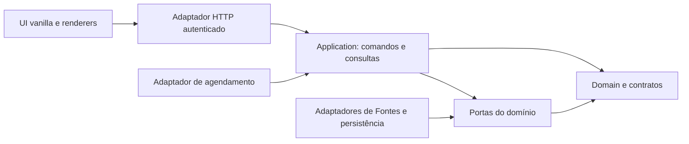
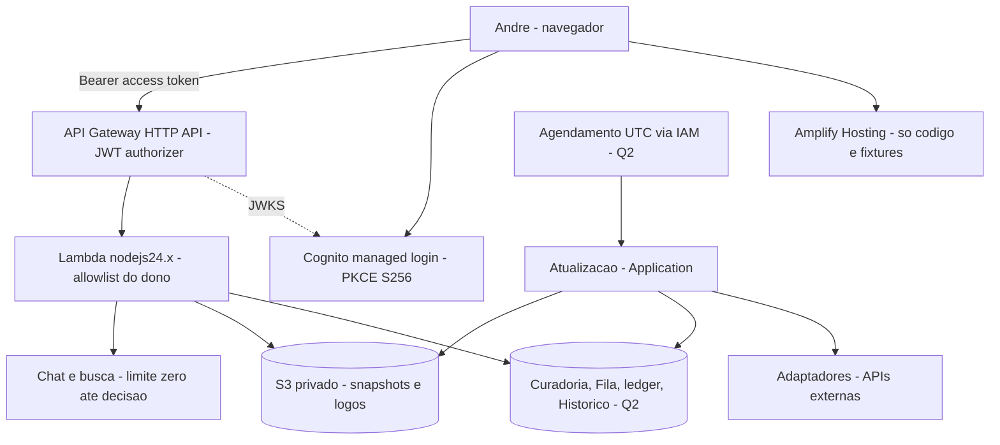
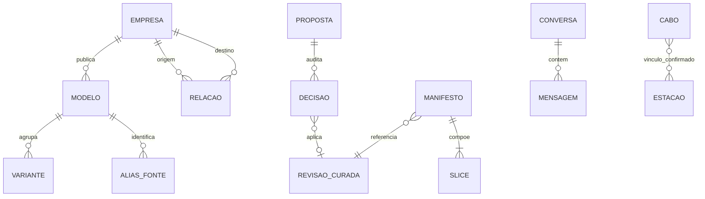

# Architecture Spine — Monitor Global de Labs de LLM

Contrato para decompor o produto em épicos. Requisitos citados do PRD/UX são herdados. AD-17 registra a escolha de integrar CesiumJS ao Globo principal; dados geográficos e provedores de tiles continuam sujeitos aos gates indicados. `final` significa decisões registradas e revisadas, sem atestar implementação, direitos de uso de fontes ou autorização de publicação.

## Design Paradigm

Monólito modular com portas e adaptadores. `domain` contém identidade, curadoria, datas, dinheiro, publicação e orçamento. `application` orquestra comandos e consultas. `adapters` traduzem fornecedores, persistência e autenticação. `ui` usa HTML/CSS/JavaScript vanilla, como herdado da UX; o renderer CesiumJS fica atrás da fronteira do Globo e não possui dados curados. Domínio não importa DOM, SDK de hospedagem, CesiumJS ou cliente LLM.



## Invariants & Rules

### AD-1 — Uma regra, um proprietário

- **Binds:** todos os módulos.
- **Prevents:** telas e provedores implementarem identidades, preços ou mutações incompatíveis.
- **Rule:** somente `domain` define essas regras; `application` é a entrada de comandos. Adaptadores convertem para contratos versionados, sem criar regras alternativas. UI consulta projeções e emite intenções.

### AD-2 — Snapshot consistente e privado

- **Binds:** FR-9, FR-14, FR-23 a FR-26, FR-30, FR-31, FR-33 a FR-37.
- **Prevents:** combinar Cadastro, Modelos e Relações de revisões incompatíveis; expor JSON privado como asset público; Empresa mesclada sumir quando o leitor salta revisões; merges em cadeia divergirem entre produtor e consumidor; rollback ressuscitar ID mesclado.
- **Rule:** armazenamento curado é a autoridade de escrita. O Publisher é o único escritor do manifesto `schemaVersion: 2`, com `revision`, `publishedAt`, `curationRevision`, refs imutáveis por slice e `companyMergedInto`. Valida integridade referencial e troca o ponteiro por compare-and-swap. `companyMergedInto` é a tabela **acumulada e compactada** de `{fromCompanyId, toCompanyId}`, de todo ID de Empresa já retirado para o sobrevivente atual. Nenhum `to` aparece como `from`: um merge `B→C` reescreve `A→B` para `A→C` e acrescenta `B→C`. Por isso a tabela vale contra qualquer revisão anterior. Ela só muda pelo Publisher, em três casos: uma `MergeDecision` humana (AD-3) consumida no commit acrescenta ou reescreve entradas; um DESFAZER compensatório (AD-4) remove a entrada e recompacta; e a retirada de uma Empresa sobrevivente regrava suas entradas com `toCompanyId: null`, que o reducer trata como `company-unavailable`. Nenhum parâmetro de publicação injeta entradas. Um único validador, `assertCompanyMergedInto(entries, {nextCompanyIds})`, em `src/contracts/`, exige `from` ausente do catálogo novo, `to` presente ou `null`, `from` único, `from ≠ to`, tabela compactada e no máximo 10 000 entradas. Publisher, `SnapshotReader` e reducer chamam esse mesmo validador. O reducer aplica só as entradas cujo `from` está no índice anterior e ignora as demais. Recovery publica uma revisão nova com as refs antigas e recalcula a tabela contra o catálogo restaurado: descarta as entradas cujo `from` voltou a existir e marca `null` aquelas cujo `to` não existe; nunca reaponta para um manifesto antigo. Publisher e leitor aceitam somente a versão 2; manifesto v1 é rejeitado, sem leitor dual, e as fixtures migram na mesma mudança. O leitor usa uma revisão por sessão de leitura (um `frame`); avanço troca o conjunto inteiro. Objetos e APIs exigem autorização do dono.

### AD-3 — Identidade e ausência de dados

- **Binds:** FR-1, FR-3, FR-9 a FR-13, FR-20, FR-26, FR-31, FR-37.
- **Prevents:** duplicatas entre Fontes, relançamentos falsos e ausência tratada como zero.
- **Rule:** IDs internos opacos são estáveis; `(source, externalId)` é único. Aliases de Modelo e variantes têm entidade proprietária explícita. Correspondência incerta vai à Fila; merge exige decisão humana. Data de Lançamento segue AA > HF > OpenRouter, preservando evidência por Fonte. Promoção de prévia para final conserva o Lançamento. Valores ausentes são `null`; dinheiro e unidades seguem `contracts.md`.

### AD-4 — Curadoria e DESFAZER auditáveis

- **Binds:** FR-13, FR-20 a FR-23, FR-31.
- **Prevents:** Agentes publicarem, aprovação aparecer antes da Atualização, DESFAZER apagar histórico ou concorrer com publicação.
- **Rule:** comandos de dono recebem `expectedRevision` estruturada e `idempotencyKey`, conforme escopos em `contracts.md`. Aprovar cria decisão staged, publicada somente na próxima Atualização válida; edição manual usa o mesmo limite de publicação. Antes de publicar, DESFAZER devolve a proposta a pending por operação atômica. Após publicar, cria proposta compensatória, exige confirmação humana e só altera a próxima revisão; a revisão anterior e a decisão original permanecem auditáveis. Rejeição guarda fingerprint do fato e evidência; reapresentação exige fato novo verificável.

### AD-5 — Autoridade limitada de Agentes

- **Binds:** FR-15 a FR-17, FR-22, FR-34, FR-35.
- **Prevents:** instruções de páginas virarem ferramentas, autoridade ou dados curados.
- **Rule:** Notícias só retornam saída de esquema fixo, sem ferramentas ou escrita. Descoberta só grava propostas; limite de dez propostas de Empresas novas por semana UTC, inclusive curadoria inicial em lotes; quota global e inserção são atômicas, replay não consome novamente. Chat v1 lê e navega, sem permissão de propor ou aprovar. IDs, links, alegações e schema são validados fora do LLM; citações só referenciam fontes realmente consultadas. Texto externo não entra no canal de instruções. Busca/fetch no servidor usa allowlist ou proteção contra SSRF e não envia credenciais a URLs geradas.

### AD-6 — Atualização idempotente e falha parcial

- **Binds:** FR-14, FR-19, FR-23 a FR-26.
- **Prevents:** cron concorrente consumir/ver publicar duas vezes, dado inválido apagar o válido, falha de uma Fonte contaminar outra.
- **Rule:** lease por slice, token de fencing crescente, chave por Fonte/escopo/janela e CAS do manifesto. Fonte tem timeout, retries limitados e schema. Coleção comparável vazia ou com menos de metade da última coleção aceita é rejeitada; não se compara com tentativa falha. Notícias incrementais vazias e consultas de ativo único têm validadores próprios. Falha preserva slice e `lastSuccessAt`; novas slices só entram após validar referências contra a revisão curada da publicação.

### AD-7 — Cadência e frescor verificáveis

- **Binds:** FR-19, FR-24, FR-25, FR-36.
- **Prevents:** UI dizer LIVE por ter acesso HTTP, bolsa fechada virar atraso ou dado velho ganhar timestamp novo.
- **Rule:** modelos/preços/Lançamentos a cada hora; Notícias a cada hora ou seis horas no modo de orçamento de 80%; ações e índices a cada quinze minutos em pregão, mais coleta pós-fechamento. `quotedAt` e `lastSuccessAt` são distintos. Calendário, fuso, sessão e cadência pertencem ao instrumento. Ausência de calendário não permite inferir pregão aberto. Estados por Fonte e agregado são calculados pela política comum de `contracts.md`; nenhuma tela recalcula com limiares próprios.

### AD-8 — Orçamento fechado por padrão

- **Binds:** FR-15, FR-16, FR-22, FR-34, FR-35 e PRD §6.
- **Prevents:** retries ou chat ultrapassarem silenciosamente o teto automático.
- **Rule:** ledger em mês UTC separa automação de chat/busca. Cada chamada paga reserva atomicamente seu máximo estimado, vinculado imutavelmente a bucket/mês UTC; os limiares usam gasto + reservado, inclusive igualdade; retry usa nova reserva, acerto ocorre uma vez e resultado desconhecido mantém reserva. Sem preço/limite verificável não se chama. A 80% Notícias passam a seis horas; a 100% suspendem-se chamadas automáticas pagas e permanecem título/link. Chat/busca começam com limite zero até verba e fornecedor decididos. Nenhuma escolha de arquitetura ativa cobrança.

### AD-9 — Autorização de ponta a ponta

- **Binds:** FR-30, todas as rotas, objetos, Histórico e mutações.
- **Prevents:** dado privado servido como asset estático; acesso por preview/origem direta; escrita com header de identidade falsificado; token em URL ou bundle.
- **Rule:**
  - **Código público, sem dados.** AWS Amplify Hosting serve apenas HTML, JS, CSS, assets públicos e fixtures sintéticas. Nunca serve Cadastro, snapshots curados, logos privados, Histórico, segredos ou tokens.
  - **Prova no build.** Em `dist/ui/app/` só entram cópias de `src/contracts`, `src/domain`, `src/application` e `src/ui`, e todo JSON ou módulo de fixture declara `provenance: 'synthetic-fixture'` (constante de `src/contracts/`). O build falha se faltar o marcador ou se houver arquivo de `tests/`, `_bmad-output/` ou `src/adapters/`. Os mockups de UX ficam fora de `/app` como referência visual com informação pública; Q8 continua governando coordenadas.
  - **Caminho dos dados.** Todo dado do dono e todo comando passam por API Gateway HTTP API com JWT authorizer do Amazon Cognito, depois Lambda `nodejs24.x`, depois S3 privado. O S3 tem Block Public Access na conta e no bucket, `BucketOwnerEnforced`, bucket policy negando `s3:authType = REST-QUERY-STRING` (sem presigned) e papel IAM mínimo. A HTTP API cobre request/response; o transporte do streaming do chat (AD-12) é decidido em Q1/Q7 com as mesmas regras de token, escopo e allowlist.
  - **Token.** Só o access token é aceito. O authorizer usa `Audience` igual ao client id, sem resource binding, e exige em cada rota um escopo do resource server `llms-api` (`llms-api/read` ou `llms-api/write`). A tabela rota→escopo vive em `src/contracts/`; `aws.cognito.signin.user.admin` nunca é escopo de rota. A Lambda confere `token_use = access`, `client_id` e `sub` contra `OWNER_SUBS` do ambiente; lista vazia nega.
  - **Login.** O user pool tem `AllowAdminCreateUserOnly` e domínio próprio. O login é só pelo managed login, com authorization code + PKCE `S256` e implicit desligado. O app client é público, sem secret. O PKCE é um módulo próprio em `src/ui/auth/` com `crypto.subtle`, sem pacote.
  - **Guarda.** Tokens ficam só em memória. Na recarga, o shell chama `/oauth2/authorize` com `prompt=none`. `code_verifier` e `state` ficam em `sessionStorage` só durante o redirect. A rota `/app/auth/callback` é a `redirect_uri` registrada: valida o `state`, apaga-o e repassa o `code` para `/app/` no fragmento (`#code=…`, que não vai ao servidor nem ao `Referer`), sem trocá-lo. A troca do code acontece em `/app/`, no mesmo documento que guarda o token em memória; o `code_verifier` é apagado nela e o fragmento é limpo com `replaceState` antes de qualquer `hydrateUrl`. Trocar o code numa página separada perderia o token na navegação de volta. O token vai no header `Authorization`, nunca na URL.
  - **Jobs.** O agendador invoca jobs por IAM/EventBridge, sem rota pública e sem `sub`.
  - **Respostas.** Respostas privadas usam `Cache-Control: private, no-store`; mutações validam Origin/CSRF, método, schema e autorização. Segredos ficam no ambiente das Lambdas e nunca nos snapshots, bundles, URLs ou logs. Origens e CORS seguem AD-26; a leitura de snapshot pela HTTP segue AD-27.

### AD-10 — Estado semântico único de experiência

- **Binds:** FR-1 a FR-8, FR-27, FR-29, FR-31 a FR-38.
- **Prevents:** projeções, bases, chat, busca e URL escolherem Empresas diferentes ou quebrarem foco/preferências.
- **Rule:** um reducer é o único escritor semântico do store: intents tipados, preferences persistidas, sessionOverrides e effectiveState separados. Hidratação de URL não dispara persistência. Avanço de snapshot reconcilia seleção/remapeamentos/janelas em uma transição; callbacks vencidos de voo/digitação não restauram intenção antiga. O Globo permanece em projeção 3D; o estado de experiência seleciona a base `MAPA|SAT`, nunca uma Vista 2D. A troca de base preserva câmera, Pontos, Relações, Filtros, Empresa selecionada e Terminal. Um seletor/projeção comum calcula uma vez o conjunto elegível/visível de Empresas a partir dos contratos e filtros ativos; renderers recebem esse conjunto e projetam as mesmas entidades, sem reavaliar predicados de Camada/Etiqueta/Laboratório; espalhamento só altera coordenadas visuais. URL restaura a base/contexto da sessão sem sobrescrever preferência persistida; compatibilidade dos parâmetros legados é Q11. O estado não guarda conversas/segredos. Lateral Leitor/Fila/MERCADOS exclusivos; `Esc` age no foco superior e completa digitação primeiro. Teclado/toque, reduzir movimento, temas, som inicialmente desligado e tokens herdam os contratos vigentes de UX, com gates de acabamento preservados.

### AD-11 — Finanças e modelos com unidades explícitas

- **Binds:** FR-9 a FR-12, FR-18, FR-19, FR-36.
- **Prevents:** comparar moedas, trocar símbolo entre bolsas ou usar preço por token como preço por milhão.
- **Rule:** um instrumento inclui ID interno, símbolo por Fonte, moeda/unidade, mercado/calendário/fuso. Origem, horário e atraso acompanham o valor; fallback por instrumento precisa cobertura verificada. Snapshot não fabrica zeros nem reserva mundial. Modelos usam preço USD por milhão; custo da tarefa é `(2000 × inputUsdPerMillion + 1000 × outputUsdPerMillion) / 1000000`, aproximado para raciocínio. Representação decimal e regras de ausência ficam em `contracts.md`.

### AD-12 — Chat e Histórico privados

- **Binds:** FR-35.
- **Prevents:** streaming incompatível, navegação inválida, retenção indefinida por omissão ou recuperação de conteúdo excluído.
- **Rule:** protocolo e tools de navegação versionados, com IDs canônicos, allowlist e validação no servidor e cliente. Ação visível na conversa; execução volta do console cheio ao painel. Histórico pertence ao dono e exige prazo configurado antes de habilitar; apagar retira acesso imediato e segue política de eliminação/backup decidida antes da story. Logs operacionais não têm conteúdo de conversa. Schema dos eventos consta em `contracts.md`.

### AD-13 — Infraestrutura geográfica independente

- **Binds:** FR-28, FR-31, FR-39, FR-40.
- **Prevents:** cabo virar Camada/Empresa/Relação ou associação geográfica virar dado afirmado.
- **Rule:** BACKBONES tem namespace e carregamento próprios, começa desligado e só é habilitado com proveniência/licença aceita. Estação ↔ cabo exige vínculo de Fonte, ausência aparece indisponível. Tiles seguem cache/atribuição do provedor e apenas viewport interativo; sem prefetch em massa/offline. Histerese evita oscilação. Falha de camada MAPA não troca a base silenciosamente para SAT; mantém o Globo e os Pontos utilizáveis e informa a indisponibilidade. Em SAT, falha do detalhe fotorealístico volta à imagem de satélite. Seleção e Empresas são preservadas nos dois casos. Provedores, zoom, bases e estilo escuro são gates antes das stories do Globo.

### AD-14 — Ambientes, recuperação e prova operacional

- **Binds:** infraestrutura, jobs e todos os testes.
- **Prevents:** teste local chamar serviço pago, dados de preview virarem produção ou rollback apagar curadoria.
- **Rule:** local/test usam fixtures sintéticas; preview/prod têm bancos, objetos, segredos, ledgers e identidades isolados. Não há deploy/cron/ativação paga automática por teste, build ou instalação. Recuperar snapshot usa ponteiro validado; banco auditado restaura separadamente. Backup privado, retenção, exclusão e recovery exigem teste antes da publicação. Logs possuem run ID, Fonte, duração, status e custo, sem conteúdo/chaves. Operação mede SM-2 e SM-3 após sete dias reais.

### AD-15 — Feedback de Notícias comum a todas as superfícies

- **Binds:** FR-14, FR-15, FR-33, FR-34, FR-35 e FR-37.
- **Prevents:** matéria marcada reaparecer no refresh, feed ou Leitor e telas divergirem em relevância.
- **Rule:** NewsId é canônico por grupo de matéria deduplicada. Comando autenticado do dono, com confirmação explícita, persiste feedback privado owner-wide; cancelar não grava. Confirmar oculta imediatamente aquela Notícia em todas as cinco superfícies e navegação/chat, independentemente do ciclo de snapshot. Toda projeção combina revisão de dados e revisão de feedback; aliases sindicatados conservam supressão. O filtro da Empresa recebe esse feedback como exemplo, sem News Agent escrever no ledger.

### AD-16 — Contratos compartilhados têm autor único

- **Binds:** fronteiras entre todos os módulos, schemas de request/response/snapshot/event/patch/state.
- **Prevents:** produtores e consumidores criarem formatos v1 diferentes para a mesma entidade ou evento.
- **Rule:** `src/contracts/` é a única definição executável de formatos de fronteira, sob responsabilidade do núcleo Domain/Contracts; produtores e consumidores importam os mesmos validadores. Antes de liberar stories independentes de uma fronteira, sua implementação de schema e fixtures válidas/inválidas precisa existir e passar nos dois lados. Registry de slices, JSON envelopes, payload de cada evento, patches e frescor pertencem a esse pacote; sua ausência bloqueia a fronteira. Mudança incompatível exige nova versão/migração, nunca heurística local.

### AD-17 — CesiumJS renderiza o Globo principal sem possuir estado de produto [ADOPTED]

- **Binds:** FR-1 a FR-8, FR-27 a FR-29, FR-31 a FR-33 e FR-37 a FR-40.
- **Prevents:** uma rota de mapa paralela divergir na seleção/filtros; coordenadas demonstrativas parecerem fatos curados; eventos de renderização alterarem dados ou preferências fora do fluxo comum.
- **Rule:** CesiumJS 1.146 é a baseline verificada para o futuro renderer do Globo, atrás da fronteira `GlobeRenderer`; a integração ainda não existe no app. A aplicação entregará ao adapter somente a projeção de Empresas elegíveis/visíveis calculada pelo AD-10, com IDs canônicos e Localizações cujo significado, precisão e evidência própria estejam validados; o adapter não recalcula filtros. Ausência/aproximação e schema exato ficam no gate Q8 e contrato comum do AD-16; a projeção fornece ao renderer a classe visual aprovada, sem inferência de precisão. Um único `GlobeSceneComposer` recebe base MAPA/SAT, tema, camadas e estado de câmera/zoom e possui as coleções da cena, aplicando a receita comum definida por Q6; adapters de provider retornam recurso/status/créditos sem mutar a cena. MAPA usa cartografia escura e revela detalhe OSM ao aproximar. SAT usa imagery de satélite em zoom amplo e transita automaticamente a fotorealismo 3D em zoom próximo coberto; zoom-out, falta de cobertura ou falha fotorealística retorna a SAT. Terreno acompanha MAPA/SAT; edifícios só são adicionados quando compatíveis, sem duplicar geometria do fotorealismo. A camada fotorealística ativa é derivada da base SAT, câmera, cobertura e disponibilidade, não uma terceira base persistida. Falha MAPA mantém MAPA selecionada e o Globo utilizável, sem trocar para SAT silenciosamente; indisponibilidade é informada. Falha de detalhe fotorealístico em SAT preserva imagery SAT. Só se mostram créditos das camadas ativas. O adapter encaminhará seleção/navegação como intents tipados ao store semântico do AD-10, sem possuir entidades curadas, filtros, preferências, persistência ou publicação. O PRD define as capacidades; as prescrições antigas de quatro Vistas em `DESIGN.md`/`EXPERIENCE.md` não prevalecem sobre FR-32 e addendum atualizados. O protótipo Cesium é referência exploratória. Pontos sem Localização validada não são apresentados como endereços precisos; coordenadas do protótipo permanecem fixtures. O adapter preserva hover de ~300 ms para Prévia, clique/toque em Ponto ou Rótulo para Terminal Fixado (sem Prévia em toque) e os fluxos existentes de foco/navegação por câmera; não acrescenta voos/controles de voo por Empresa/região nem cartões próprios. Provider e fonte imagery continuam sujeitos a Q6. Cada provider exige aprovação de fonte/licença, modelo de credencial (escopo mínimo/restrição de origem/ambiente/rotação quando aplicável), crédito visível e acessível, custo/quota, cache/Referer permitido e fallback. Credenciais privadas/de escrita nunca entram no browser; credenciais públicas do cliente são específicas do app/ambiente, restritas e monitoradas. Ao trocar base ou encerrar o renderer, `dispose` remove listeners/subscriptions e cancela cargas; conclusões/eventos de geração de cena vencida são ignorados. A carga usa versão fixada e serve assets/workers pela estratégia escolhida. Só MAPA/SAT e camadas disponíveis/implementadas podem ser selecionadas.

### AD-26 — Uma origem canônica por ambiente

- **Binds:** AD-9; shell de navegador, API, Cognito e headers de todos os ambientes.
- **Prevents:** a CSP do shell bloquear a API ou o Cognito; quatro listas de origem divergirem entre CORS, Lambda, callbacks e CSP; preflight cair no authorizer e receber 401; o preview aceitar chamadas da origem de produção ou o contrário.
- **Rule:** cada ambiente declara **uma** `APP_ORIGIN` na IaC, e ela é a única fonte para `allowOrigins` do HTTP API, a checagem de `Origin` na Lambda, as callback/logout URLs do Cognito e a CSP do shell. A API é cross-origin: a CSP de `/app/**` tem `connect-src 'self' <API_ORIGIN> <COGNITO_DOMAIN>`, gerada dessas origens e nunca escrita à mão. CORS é configurado só no API Gateway, com rota `OPTIONS` sem autorização; a Lambda não emite cabeçalhos CORS. O domínio `amplifyapp.com` não pode ser removido, mas pode ser bloqueado por WAF; não é bloqueado porque só serve código. Com domínio próprio, ele não é origem aceita pela API. Previews de PR ficam desligados ou presos ao ambiente de preview. `API_ORIGIN`, `COGNITO_DOMAIN` e `CLIENT_ID` chegam ao shell por um único módulo de configuração pública gerado pelo build de cada branch, sem segredo.

### AD-27 — Contrato HTTP de leitura de snapshot

- **Binds:** AD-2, AD-9, AD-16; Lambdas de leitura e `SnapshotReader`.
- **Prevents:** chave interna do S3 vazar para o navegador; a Lambda reserializar a slice e reprovar todo digest; 401 manter dado privado na tela; slices de revisão recém-superada responderem 404 em loop; leitores fazerem um GET de manifesto por tecla.
- **Rule:** `PublishedManifest` (interno, com `objectKey`) e `ManifestResponse` (externo, sem `objectKey`, com slices endereçadas por nome em `GET /api/v1/snapshots/:revision/:slice`) são dois schemas de `src/contracts/`. O `SnapshotReader` valida o `ManifestResponse`. A resposta de slice são os bytes gravados, sem reserialização nem base64, e uma fixture compartilhada prova a igualdade de digest entre Lambda e navegador. O shell tem uma única porta HTTP, que mapeia assim:
  - 401: uma renovação pelo refresh token em memória (`/oauth2/token`, sem redirect) e uma nova tentativa; se falhar, `AccessDeniedError`;
  - 403: `AccessDeniedError`;
  - 404/410 de slice: `RevisionSupersededError`, e a raiz faz um único refresh;
  - 5xx: erro genérico.

  `AccessDeniedError` emite um único evento `access-lost` para a raiz de composição, que executa o descarte e só então decide o redirect `prompt=none`. A porta HTTP vive em `src/ui/http-snapshot-port.mjs` e o login em `src/ui/auth/`. As três últimas revisões continuam legíveis, e a limpeza de órfãos respeita isso. `revision` casa com `^[A-Za-z0-9._-]{1,128}$`. Só a raiz de composição chama `refresh`: na carga, por intervalo e em `visibilitychange`. Cada `frame` lê `reader.current`.

## Consistency Conventions

| Concern | Convention |
| --- | --- |
| Contratos | Rotas `/api/v1`. `schemaVersion` é por contrato, com a tabela de versões em `contracts.md`: manifesto 2, estado e intents de exploração 2, Busca 1, demais 1. Cada contrato evolui sob AD-16 sem arrastar os outros. Incompatibilidade rejeita; migração explícita. Campos JSON camelCase; IDs strings opacas. |
| Datas | ISO 8601 UTC com `Z`; UI mostra fuso. Relógio injetável nos testes. Datas desconhecidas são null, não data de ingestão. |
| Erros | `{error:{code,message,retryable},requestId}`; sem stack/chave/conteúdo externo; 401/403 acesso, 409 revisão, 422 schema, 429 limite, 503 dependência. |
| Comandos | Autorização, schema, idempotência e revisão antes do efeito; nenhum GET altera estado. |
| Atribuição | Fonte/url/fetchedAt por valor ou registro; licenças e marca preservadas em toda superfície correspondente. |
| Entidades | Empresa tem uma Camada principal e zero+ Etiquetas; Laboratório é classificação elegível, inclusive por Etiqueta; cinco Camadas fixas. |

## Structural Seed

`[ASSUMPTION]` Base observada: aplicação em JavaScript ES modules (`src/**/*.mjs`), reducer/contratos compartilhados e scripts Node; Vite, TypeScript e Cesium (com seus web workers) não estão instalados/configurados no app principal. Preservar essa base JS como origem do store e dos contratos; não presumir conversão a TypeScript. Vite vanilla JS é alternativa de build, não escolha feita. Hospedagem e camada autenticada são AWS (AD-9): Amplify Hosting para o código, Cognito, API Gateway HTTP API, Lambda e S3 privado; nada está provisionado além do Amplify de preview. Persistência de controle, agendador e IaC continuam sob Q2. O store de exploração vive em `src/application/` (testável sem navegador); `src/ui/` é o shell de navegador e os renderers. Handlers Lambda são adaptadores que importam os mesmos validadores de `src/contracts/`. CesiumJS 1.146 é a baseline de integração escolhida e verificada; nenhum pacote foi instalado para o app principal. Q9 decide CDN ou pacote NPM/Vite e a forma de servir assets/workers, mantendo uma única instância dos módulos atuais. Evidências e alternativas estão em [technology-evidence.md](technology-evidence.md) e o handoff de integração em [cesium-integration.md](cesium-integration.md). O renderer exige benchmark do envelope completo e fallback aprovado antes da adoção operacional.





```text
src/contracts/      schemas/validadores compartilhados e fixtures
src/domain/         identidade, valores, curadoria, frescor, orçamento
src/application/    atualizar, publicar, revisar, pesquisar, store de exploração
src/ports/          Fonte, repositórios, auth, LLM, clock
src/adapters/       handlers Lambda, S3, provider, scheduler (nunca no bundle)
src/ui/             shell de navegador, componentes vanilla, renderers
tests/              fixtures sintéticas, contratos, E2E privados
```

## Capability → Architecture Map

Os 40 FR, NFR e gates de origem estão em [coverage.md](coverage.md). O protótipo não substitui critérios de integração.

| Capability / Area | Lives in | Governed by |
| --- | --- | --- |
| Globo CesiumJS | `ui/globe` chama `GlobeRenderer`; adapter projeta IDs/localizações e devolve intents tipados | AD-10, AD-13, AD-17 |

## Deferred

- **Q1/Q7, antes das stories de chat/LLM:** Andre decide orçamento adicional, limite de suspensão, providers LLM/busca e retenção/exclusão. Chat permanece desativado. Teto automático próximo de US$5 não cobre custos novos por inferência.
- **Q2, antes das stories de infraestrutura e de qualquer dado real no navegador:** provedor e camada autenticada estão decididos em AD-9. Faltam: a persistência de controle com CAS, lease, fencing e ledger (candidato DynamoDB com escrita condicional, não verificado); o agendador UTC (candidato EventBridge Scheduler); a ferramenta de IaC (Amplify Gen 2, SAM ou CDK); a região; custo total e quotas, inclusive o limite de 6 MB de payload da Lambda; um user pool, domínio, callbacks, bucket, API e `APP_ORIGIN` por ambiente (AD-14, AD-26); deploy de backend só por pipeline explícito em branch protegida, nunca por push comum (AD-14); logos privados lidos por `fetch` com header, não por `img src`; e as provas de autenticação, de recusa de URL presigned, de CAS, de recovery e de backup. Até lá, o navegador recebe só fixtures sintéticas.
- **Q3, antes das stories do Globo e UI afetadas:** projeção fixa 3D e bases MAPA/SAT estão definidas no PRD. UX fecha controles móveis, ordem/foco por muitos Pontos, contraste e legibilidade sobre MAPA/SAT, teclado, leitor de tela, toque/pinça e redução de movimento. Detalhes antigos de quatro Vistas, mapa plano e texturas diurnas/noturnas não são herdados. DESIGN/EXPERIENCE continuam rascunhos e não prevalecem sobre o PRD final.
- **Q4, antes de fonte/publicação BACKBONES:** demonstrar origem/data/licença e associação estação/cabo. Os assets existentes continuam protótipo.
- **Q5, antes de MERCADOS:** matriz de cobertura, símbolos confirmados, reserva por instrumento, unidades, histórico e calendários/fusos de todas as bolsas/macro/cripto. Sem cobertura comprovada, dado indisponível permanece explícito.
- **Q6, antes das stories de mapa/Globo:** os comportamentos de produto já fixados por AD-17/PRD não são reabertos: cartografia escura/OSM no zoom em MAPA; imagery de satélite ampla e transição automática a fotorealismo em zoom próximo coberto em SAT; terreno nas duas bases; edifícios compatíveis sem duplicação; falha em MAPA não muda a base para SAT, e falha fotorealística em SAT retorna a imagery SAT. Escolher a base inicial e provar uma composição tecnicamente compatível que cumpra essas regras. Fechar provedores, cobertura, fonte/licença, credenciais/restrição de origem, custo/quota/monitoramento, créditos acessíveis, cache/Referer, compatibilidade com temas e limiares/histerese. Para Google Photorealistic 3D Tiles, a orientação oficial recomenda restringir a chave Map Tiles API por IP; Q6 precisa provar caminho de requisição browser compatível com a restrição e os termos ou selecionar alternativa, sem chave irrestrita no cliente. A documentação Cesium do quickstart de fotorealismo desativa o globo padrão para conteúdo Google global; logo, não presumir composição simultânea com imagery SAT ou terreno sem teste/provider aprovado. Se usar `tile.openstreetmap.org`, cumprir HTTPS, Referer válido, cache headers, crédito e vedação a prefetch em massa.
- **Q8, antes de carregar pontos reais no Globo:** Andre confirma o que cada ponto representa (por exemplo, matriz, escritório, laboratório ou local aproximado), evidência/precisão aceitas e quais localizações demonstrativas podem ser descartadas; também mapeia cada classe para ponto/região/omissão, elegibilidade para seleção e limite de aproximação da câmera. Sem coordenada utilizável, a projeção omite o marcador. Fechar o contrato comum antes das stories.
- **Q9, antes do scaffold do renderer:** decidir CDN fixada ou pacote NPM/Vite para a base `.mjs` existente (importar módulos atuais ou definir migração explícita), servir assets/workers, CSP/cache e compatibilidade WebGL. O spike define matriz de navegadores/dispositivos, perda/restauração de contexto WebGL, tamanho, desempenho e estado/fallback comum: manter seleção, informar camada indisponível e preservar a base/intenção do usuário; habilitar apenas camadas e bases implementadas.
- **Q10 (resolvido por Andre em 12/10/2026):** Globo principal permanentemente 3D, com bases MAPA/SAT; MAPA escuro com OSM em zoom; SAT com imagem ampla e fotorealismo automático próximo quando coberto; terreno e edifícios compatíveis; sem voos. Preservar store, busca/filtros, câmera/foco e ações existentes. Q3/Q6/Q8/Q9 governam UX/acessibilidade, providers, geodados e integração.
- **Q11, extensão de 14/10 (antes da story de URL do Epic 7):** `?company=` de um link anterior a um merge hoje vira `null`. Resolver pela tabela `companyMergedInto` na hidratação muda o estado de exploração e exige `EXPLORATION_VERSION` 3 sob AD-16.
- **Q11 (resolvido pela arquitetura em 12/10/2026; implementação antes das stories de store/URL):** estado canônico usa `base: MAPA|SAT`, intent de troca de base e projeção 3D fixa; URL nova serializa `base`. `view=MAPA|SAT` são aliases legados, `view=3D` não escolhe uma base, `view=2D` cai na base inicial configurada sem projetar mapa plano, e `base` prevalece se coexistir com `view`. A base inicial segue aberta em Q6. Domain/Contracts publica schema e fixtures executáveis via AD-16 antes das stories consumidoras.
- Detalhes de tabelas SQL, componentes, biblioteca gráfica e dimensões visuais serão definidos no épico responsável, respeitando os contratos; não podem criar identidades/publicadores/stores paralelos.
