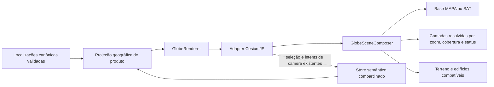

# Handoff técnico — integração CesiumJS no Globo

**Propósito:** orientar a equipe implementadora sobre a fronteira de integração e os gates técnicos da fatia CesiumJS.  
**Público:** engenharia que vai integrar o renderer ao produto.  
**Estado:** contrato de arquitetura; não afirma integração ou dados geográficos em produção.

## Decisões já fixadas

- CesiumJS integra o Globo principal atrás de `GlobeRenderer`; não haverá rota experimental como produto paralelo.
- A projeção do Globo permanece sempre 3D. O usuário alterna somente entre as bases `MAPA` e `SAT`; terreno acompanha ambas e edifícios aparecem onde forem compatíveis.
- MAPA usa cartografia de fundo bem escuro e mostra mais detalhes de cidades, rodovias e ruas do OpenStreetMap à medida que o usuário aproxima o zoom.
- SAT mostra imagem de satélite em zoom amplo. Em área coberta e zoom próximo, o conteúdo fotorealístico 3D entra automaticamente. Zoom-out, falta de cobertura ou falha fotorealística restaura a imagem SAT. A transição não é uma terceira base selecionável.
- Não incluir voos ou controles de voo por Empresa/região do protótipo. Preservar as ações de foco e navegação por câmera que já pertencem ao produto.
- CesiumJS 1.146 é a baseline verificada em 12/10/2026. Fixar a versão usada pelo app e servir os assets/workers exigidos pela estratégia de integração aprovada.
- Provedores de cartografia, satélite, terreno, edifícios e fotorealismo são decisões separadas. Nenhum provider, chave, custo, cobertura ou licença foi aprovado por escolher CesiumJS.
- Os 35 pontos do protótipo servem apenas para demonstração; nenhuma coordenada representa uma localização corporativa aprovada.

## Estado e compatibilidade com o código atual

O produto mantém projeção 3D fixa e introduz um estado semântico de base `MAPA|SAT`, com intent de troca de base e disponibilidade explícita das bases/camadas. A composição fotorealística é derivada da base SAT, câmera/zoom, cobertura e status do provider; nunca persiste como terceira base. A troca de base não reinicializa o Viewer, não chama home/morph nem move a câmera. Seleção, filtros, Empresa, Relações e Terminal permanecem no store comum.

Hoje `src/contracts/exploration.mjs` define `VIEWS` como `3D`, `2D`, `MAPA` e `SAT`; o reducer inicia em `view: '3D'`, e `src/domain/exploration-url.mjs` lê e escreve `view`. Essa forma mistura projeção e base e não é o contrato do produto atualizado. Antes das stories, migrar o estado para `base`, a intent para troca de base e `availableBases` para MAPA/SAT. A URL nova serializa `base=MAPA|SAT`. Compatibilidade recomendada: aceitar `view=MAPA` e `view=SAT` como aliases legados; `view=2D` não restaura projeção plana e cai na base inicial configurada; `view=3D` não escolhe uma base. Se `base` e `view` vierem juntos, `base` é canônica. A base inicial permanece aberta em Q6.

A câmera continua sob controle da instância ativa do renderer; a troca da base muda as camadas compostas, mas preserva a posição e a orientação da câmera. Ações existentes de focus/go-to podem comandar a câmera por intents do produto. Eventos de seleção voltam ao store, que continua autoridade para seleção e navegação.

## Composição da cena

| Estado do produto | Cena esperada | Fallback exigido |
| --- | --- | --- |
| `base=MAPA` | Cartografia bem escura; detalhe OSM de cidades, rodovias e ruas aumenta ao aproximar; terreno e edifícios compatíveis | Se a camada MAPA falhar, o Globo e os Pontos permanecem utilizáveis, a indisponibilidade é informada e a base não muda silenciosamente para SAT |
| `base=SAT`, zoom amplo ou sem cobertura fotorealística | Imagem de satélite, com terreno onde aprovado e disponível | Preservar a imagery SAT se a camada opcional falhar |
| `base=SAT`, zoom próximo e coberto | Transição automática para fotorealismo 3D; não adicionar edifícios duplicados já representados nele | Ao afastar, sair da cobertura ou falhar a camada fotorealística, retornar à imagem SAT |

Um único `GlobeSceneComposer` é dono das coleções Cesium de imagery, terreno, edifícios e tiles fotorealísticos. Adapters de provider entregam recurso, cobertura, status e crédito; não mutam a cena nem o store. Q6 define limiares e histerese para evitar alternância repetida perto da fronteira. Falhas são tratadas por base/camada e não alteram silenciosamente a escolha do usuário. Somente créditos das camadas ativas aparecem, legíveis em todos os temas e no celular.

O quickstart oficial Cesium para Google Photorealistic 3D Tiles desativa o globo padrão porque o conteúdo cobre o globo. Isso não comprova composição licenciável ou tecnicamente correta com imagery SAT e terreno do produto. Google continua candidato, não decisão; provar a combinação e o caminho de credenciais/termos ou escolher provider compatível em Q6.

## Interações que o adapter preserva

- O AD-10 calcula uma vez as Empresas elegíveis/visíveis e a projeção de localizações validadas; Cesium não reavalia filtros ou regras de Camada/Etiqueta/Laboratório.
- Hover desktop por cerca de 300 ms pode abrir Prévia. Clique/toque em Ponto ou Rótulo seleciona a Empresa e abre Terminal Fixado; toque não abre Prévia.
- Busca, seleção, filtros, foco e ações de câmera seguem o store e fluxos do produto original. Não portar a lista local, busca/filtros paralelos, controles extras de voo, toggle manual do mock ou cartão de detalhe próprio do protótipo.
- Teclado, toque, leitor de tela e redução de movimento permanecem requisitos. Controles móveis, ordem de foco para até ~200 Pontos e contraste sobre MAPA/SAT continuam no gate Q3.
- Pontos sem Localização validada não aparecem como endereços precisos. Até Q8, usar apenas fixtures sintéticas; as 35 coordenadas do mock não migram para o produto.

## Portões antes das stories afetadas

| Gate | Precisa estar definido antes de | Estado |
| --- | --- | --- |
| Q3 — UX e acessibilidade | controles móveis, ordem/foco, leitores de tela, teclado/toque, contraste/legibilidade em MAPA/SAT, redução de movimento e acabamento visual | Pendente; projeção 3D e bases MAPA/SAT já estão decididas pelo PRD |
| Q6 — provedores e composição | base inicial; selecionar e provar provider/composição compatíveis com as regras fixas acima; cobertura/licença; créditos; credenciais; custo/quota; cache/Referer; limiares/histerese e compatibilidade de tema | Pendente; o comportamento do produto está fixado. Google ainda não foi aprovado; as tiles fotorealísticas podem exigir `globe: false`, por isso é preciso comprovar compatibilidade com navegadores, termos e composição antes da ativação |
| Q8 — semântica geográfica | significado/evidência/precisão por localização e política para ponto/região/omissão, seleção e limite de câmera | Pendente com Andre; até lá apenas fixtures |
| Q9 — carregamento e compatibilidade | CDN fixada ou pacote NPM/Vite para `.mjs`; assets/workers; CSP/cache; navegadores/dispositivos; perda/restauração WebGL; tamanho, desempenho e estado/fallback compartilhado | Spike antes do scaffold |
| Q11 — migração de estado/URL | schema e fixtures comuns para estado `base`, intent, disponibilidade MAPA/SAT e aliases legados `view`, conforme AD-16 | Regra de compatibilidade decidida; implementar e cobrir na story do store/URL |

Até fechar Q3/Q6/Q8/Q9/Q11, CesiumJS pode ser validado com fixtures sintéticas, sem dados corporativos não verificados ou providers em produção. Nenhuma chamada paga, ativação ou integração é autorizada por este documento.

## Regras para implementação

1. Renderer recebe IDs canônicos e Localizações com semântica, precisão e evidência definidas pelo contrato AD-16/Q8; nenhuma inferência de precisão no adapter.
2. Cesium não armazena entidades, filtros, preferências, seleção canônica ou publicação. Toda seleção volta como intent tipado ao reducer.
3. Trocar MAPA/SAT preserva a mesma instância da cena, câmera, Pontos, Relações, Filtros, Empresa selecionada e Terminal.
4. Uma composição calcula imagery/terreno/edifícios/fotorealismo; o resolver de camada usa base, zoom, cobertura e status e aplica a transição automática SAT especificada.
5. Ao trocar base ou encerrar o renderer, descartar subscriptions/listeners e cancelar cargas pendentes; ignorar conclusão de carga de cena vencida.
6. Medir carga inicial, memória, fluidez e fallback em viewport global/urbano e no envelope de ~200 Empresas, em notebook e celular, antes de habilitar por padrão.

## Evidência e limites

- [CesiumJS releases](https://github.com/CesiumGS/cesium/releases) lista 1.146, publicada em 01/10/2026; a partir dessa versão, há o pacote `@cesium/core`; validar sua adoção no spike de Q9.
- O [quickstart Cesium para Photorealistic 3D Tiles](https://cesium.com/learn/cesiumjs-learn/cesiumjs-photorealistic-3d-tiles) recomenda `globe: false` para usar a cobertura global Google como base. Isso alerta para composição, não determina o provider.
- O [quickstart CesiumJS](https://cesium.com/learn/cesiumjs-learn/cesiumjs-quickstart/) documenta CDN/npm e assets/workers. A [política Google Maps Tile API](https://developers.google.com/maps/documentation/tile/policies) restringe cache/uso e exige créditos visíveis. A política [OSMF Tile Usage](https://operations.osmfoundation.org/policies/tiles/) governa o endpoint público OSM; provider alternativo não fica sujeito às mesmas regras automaticamente.
- A documentação de alternativas permanece em [technology-evidence.md](technology-evidence.md), e os invariantes aprovados estão no [spine](ARCHITECTURE-SPINE.md).

A integração CesiumJS, as licenças, a cobertura, o benchmark, a acessibilidade e o uso de providers reais ainda exigem validação própria; o reviewer gate e as evidências citadas cobrem somente os documentos.
