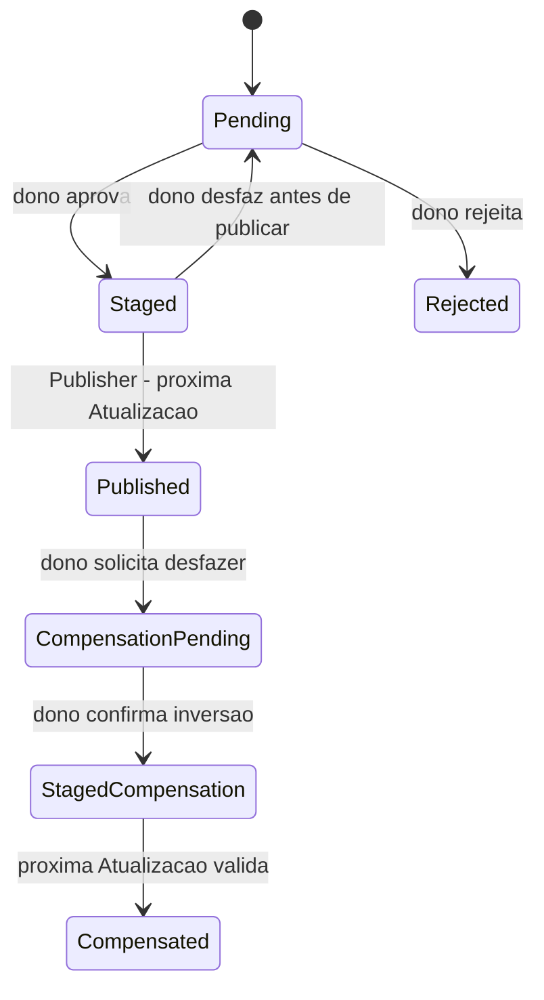

# Contratos entre módulos

Complemento normativo da [spine](ARCHITECTURE-SPINE.md). São contratos, sem endpoints implementados nesta etapa.

| Contrato | `schemaVersion` vigente |
| --- | --- |
| Manifesto (`PublishedManifest`, `ManifestResponse`) | 2 |
| Estado e intents de exploração (`EXPLORATION_VERSION`) | 2 |
| Busca (`SEARCH_VERSION`) | 1 |
| Envelopes de slice, entidades, comandos, ledger, streaming | 1 |

## Identidade, dinheiro e tempo

- `CompanyId`, `ModelId`, `VariantId`, `InstrumentId`, `NewsId`, `ProposalId` e `RevisionId` são strings opacas estáveis. IDs de Fontes ficam na tabela de correspondência, nunca viram identidade da UI. `source + externalId` tem unicidade.
- `Company` tem `primaryLayer` em `labs|chips|cloud|energy|software`, `tags` sem duplicatas, `isLab`, `location`, `sourceRefs`, versão curada. Uma `Location` precisa distinguir ausência e aproximação de um ponto preciso, usar WGS84 quando houver coordenadas, registrar significado geográfico, precisão e evidência vinculada à própria localização (não apenas fontes da Empresa); o schema executável exato e o mapeamento de qualidade para ponto/região/omissão, seleção e limite de câmera são gate Q8 e devem ser únicos em `src/contracts/` conforme AD-16. Até Q8, coordenadas são fixtures sintéticas e nenhum ponto real é publicado/renderizado como endereço preciso. `isLab` usa critérios do PRD e evidência própria; não é deduzido só da Camada principal.
- `Model` é a família canônica de Lançamento do Laboratório; variantes carregam suas métricas/preços/licenças/contexto e aliases. UI usa a família uma vez e identifica a variante usada na comparação. Merge/split humano conserva trilha de IDs; referências obsoletas retornam substituição explícita ou 410, nunca identificam outra entidade por acidente.
- Preço e valores monetários são strings decimais de base 10, sem separador de milhar; cálculos usam decimal ou inteiros escalados e só arredondam na apresentação. `null` = sem dado, `"0"` = zero fornecido. Adaptadores OpenRouter normalizam por token para USD por milhão uma única vez.
- `NewsResult` mantém `relevantCompanyIds` separado de `citedCompanyIds`: relevância é avaliada por Empresa-alvo, enquanto uma Empresa apenas citada pode ter link no Leitor sem receber a matéria em suas Notícias. Projeções, limites por Empresa e LABS usam apenas relevantes; empresas citadas só navegam quando resolvidas no Cadastro.

Cada valor dinâmico inclui `source`, `sourceRecordId`, `sourceUrl`, `observedAt` quando disponível e `fetchedAt`. Notícias incluem URL original, idioma, `publishedAt`, título original e resumo com `generatedByAi: true`. Em falha de resumo, objeto de origem permanece sem resumo.
- `releaseAt` resulta da precedência por Fonte; timestamp inválido/futuro fica fora do cálculo de Pulso e gera alerta. Idade entre zero e sete dias gera intensidade `1 - age / 7d`; fora disso não há Pulso. Reduzir movimento usa destaque estático.

## Leitura e publicação

`GET /api/v1/snapshot` devolve manifesto privado. `GET /api/v1/snapshots/:revision/:slice` só devolve objeto alcançável daquela revisão autorizada, com digest/schema validados. O registro executável em `src/contracts/` define chaves de slices, envelopes/projeções, formatos de `location`, sourceRefs, status, requests/responses, patches e cada payload do streaming. Domain/Contracts é autor único; stories consumidoras aguardam esses schemas e fixtures. O exemplo acima não dá permissão para inferir os demais formatos. Leitor mantém última revisão completa se algum fetch novo falhar; não combina catálogo novo com Modelo/Relação antigos não reconciliados.

Manifesto interno (`PublishedManifest`, versão 2, AD-2):

```json
{
  "schemaVersion": 2,
  "revision": "r-2026-10-10T12.00Z",
  "publishedAt": "2026-10-10T12:00:00Z",
  "curationRevision": "opaque",
  "slices": {
    "catalog": {"objectKey": "private-key", "digest": "sha256", "lastSuccessAt": "2026-10-10T12:00:00Z"},
    "models": {"objectKey": "private-key", "digest": "sha256", "lastSuccessAt": "2026-10-10T11:00:00Z"}
  },
  "companyMergedInto": [
    {"fromCompanyId": "opaque-a", "toCompanyId": "opaque-c"},
    {"fromCompanyId": "opaque-b", "toCompanyId": "opaque-c"}
  ]
}
```

`companyMergedInto` é acumulada e compactada: lista todo ID de Empresa já retirado com o sobrevivente atual (ou `null`, se o sobrevivente foi retirado), e nenhum `to` aparece como `from`. Muda só por `MergeDecision` humana, DESFAZER compensatório (remove e recompacta), retirada do sobrevivente (`to: null`) ou recovery (recalculada contra o catálogo restaurado). É `[]` enquanto não houver merge. O validador único `assertCompanyMergedInto(entries, {nextCompanyIds})` exige `from` ausente do catálogo novo, `to` presente ou `null`, `from` único, `from ≠ to`, compactação e no máximo 10 000 entradas; o reducer indexa a tabela num `Map`/`Set`. Publisher, `SnapshotReader` e reducer o chamam; o reducer aplica só entradas cujo `from` está no índice anterior. Manifesto v1 é rejeitado; não há leitor dual. `revision` casa com `^[A-Za-z0-9._-]{1,128}$`.

`GET /api/v1/snapshot` devolve `ManifestResponse`: o mesmo objeto sem `objectKey`. Cada slice é lida por nome na rota de slice, que devolve os bytes gravados sem reserialização. As três últimas revisões continuam legíveis (AD-27). Inventário de migração, a cargo da story Domain/Contracts: `assertManifest` v2 com fixtures válidas e inválidas; `MemorySnapshots` passa a emitir v2; testes que montam manifesto à mão migram; `src/ui/fixture-source.mjs` gera o manifesto pelo mesmo helper, nunca por literal; um teste falha se houver manifesto v1 em qualquer lugar. No domínio e na aplicação: o reducer troca a checagem própria (`exploration-state.mjs`, `INVALID_REMAP` para `from` fora do índice anterior) pelo validador único com filtro pelo índice anterior; os testes que exigem esse lançamento (`tests/exploration.test.mjs`) passam a exigir que a entrada seja ignorada; `LocalNewsView` expõe `companyMergedInto` no frame e `LocalSearch` deixa de enviar `companyRemaps: []` fixo. O formato do intent não muda, então `EXPLORATION_VERSION` continua 2.

O exemplo é formato, não dado operacional. Publisher valida todos os IDs referenciados contra a revisão curada. Uma slice antiga só é preservada quando suas referências continuam válidas; exclusão/merge de entidade exige remapeamento curado ou impede publicar até resolução. Objetos gravados sem ponteiro concluído são órfãos privados; limpeza posterior usa retenção e nunca torna públicos.

## Fila e comandos

`GET /api/v1/proposals` lê propostas. `POST /api/v1/proposals/:id/decisions` recebe `approve|editApprove|reject|undo`, `expectedRevision: {proposalVersion, curationRevision, targetVersions}`, `idempotencyKey` e patch limitado a campos do tipo de proposta. Edição manual usa `POST /api/v1/catalog/commands` com a mesma autorização, revisão e publicação staged.



Uma proposta pode gerar múltiplas decisões; todas são append-only. Revisão da proposta (`proposalVersion`) protege approve/undo; `curationRevision` identifica o snapshot curado lido, e `targetVersions` guarda a versão de cada entidade que o patch toca (criação exige ausência). Publisher compara versões dos alvos com o banco atual, não exige que decisões disjuntas tenham uma revisão global nova. Aprovações disjuntas feitas no mesmo baseline podem publicar juntas. Se várias decisões staged tocam o mesmo alvo, o plano não aplica nenhuma delas até reconciliação humana; todas ficam staged com conflito. Alvo alterado desde a aprovação também fica em conflito. O conjunto restante publica atomicamente na próxima revisão. O commit revalida estado staged e proposalVersion de cada decisão selecionada, versões dos alvos, curationRevision atual, expectedSnapshotRevision e fencing token. Se DESFAZER venceu primeiro, versão/estado mudou e nenhuma decisão cancelada é aplicada; se publicação venceu, DESFAZER segue compensação pós-publicação. A chave de idempotência inclui dono + comando + recurso; lote tem ID imutável e ordenação por sequence de decisão persistida. Consumo de decisão ocorre exatamente uma vez dentro do commit. Edição manual segue a mesma regra; nenhuma resolução por last-write-wins. Repetição da mesma chave/comando retorna resultado anterior; mesma chave com payload diferente = 409. Proposta rejeitada só volta com novo Modelo canônico publicado ou nova Fonte independente que confirme o campo; timestamp de fetch diferente não é fato novo.

## Atualização, freshness e reserva

Baseline de volume = última coleção aceita da mesma Fonte + parâmetros/escopo/schema. Vazio rejeita coleção full; `newCount < oldCount / 2` rejeita, exatamente metade passa. Validador de incremental news admite vazio e preserva itens dentro de duas semanas, com até cinco por Empresa. Dedup por URL canônica e evidência de conteúdo sindicado é determinístico; não elimina matérias distintas só por título similar.

Lease tem `scope`, `ownerRunId`, `expiresAt` e `fencingToken` monotônico. Cada escrita confere token vigente; execução expirada não publica depois da nova. Chave de execução inclui janela e Fonte. Até três tentativas por fetch com backoff/jitter respeitam limite da Fonte; chamadas LLM pagas exigem reserva para cada tentativa. Manifesto aponta objetos somente depois de gravados/validados; trocar ponteiro e aplicar decisões é transação/CAS conjunta no repositório de controle: perder CAS ou fencing aborta todos os efeitos do plano. Update com zero linhas não é considerado sucesso; um batch que confirma decisões mesmo com CAS perdido viola o contrato. Provar rollback efetivo é gate da infraestrutura; orçamento de chamadas externas já feitas é ledger separado e nunca se apaga por rollback de publicação.

Política compartilhada de estado (regras abaixo aplicadas nesta precedência):

| Situação | Resultado |
| --- | --- |
| Sem conexão observada pelo cliente | UI OFFLINE; dados em memória mantêm timestamps e estado anterior por Fonte. |
| Sem dado válido, Fonte desabilitada ou credencial inválida | Fonte OFFLINE e motivo. |
| Três falhas consecutivas e mais de duas cadências sem sucesso | Fonte OFFLINE, preservando dados com data. |
| Horário de origem obrigatório ausente/impossível ou calendário de mercado não confirmado | ATRASADO/horário não validado; sem inferir pregão. |
| Falha mais recente que sucesso, ou idade de coleta/origem excedida | Fonte ATRASADO, preservando dados. |
| Bolsa fechada com último close válido da sessão esperada e coleta pós-close concluída, sem falha posterior | LIVE/mercado fechado até próxima coleta exigida. |
| Última validação e timestamp de origem válidos, dentro do prazo esperado, sem falha posterior | Fonte LIVE, mostrando atraso original; LIVE não significa tempo real. |

Idade da coleta não pode exceder duas cadências esperadas enquanto houver coleta devida. Fora do pregão, o prazo é o `nextDueAt` calculado pelo calendário da sessão: close esperado validado e pós-close concluído continuam válidos até esse prazo, sem expirar por30min de relógio corrido no fim de semana/feriado. Cotação em pregão exige timestamp de origem e idade ≤ duas cadências (30min) mais atraso declarado do provider; sem atraso documentado, não somar tolerância presumida. Fora do pregão, usar close da sessão esperada do calendário. Dados de Modelo com asOf upstream usam prazo de duas horas; se Fonte omite asOf (campo opcional no contrato dessa Fonte), coleta validada dentro de duas cadências e sem falha posterior tem estado de coleta LIVE com `sourceAge: unknown` e indicação de idade de origem desconhecida. A exigência de timestamp válido da última linha aplica-se quando a Fonte fornece ou é obrigada a fornecer asOf; jamais fabricar timestamp. Cotações continuam obrigadas a fornecer horário de origem. `releaseAt` e `publishedAt` de matéria não são asOf: notícias podem ter até duas semanas sem que isso seja falha de coleta. Macro/cripto aguardam política por instrumento em Q5. Timestamp futuro além de cinco minutos de skew é inválido; sucesso HTTP nunca renova observedAt de dado velho.

Estado agregado: se todos os tipos habilitados estão LIVE, LIVE; se nenhum tem dado válido disponível, OFFLINE; demais falhas/parcialidade, ATRASADO. Tipo opcional desativado por gate não conta no agregado e mostra sua indisponibilidade na superfície. Fonte fallback não apaga a falha da principal: dado efetivo pode ficar LIVE com origem de reserva e problema principal visível. Notícias a 100% do budget mostram resumo suspenso por orçamento; status de coleta não finge frescor de resumo.

`Instrument` exige moeda, unidade, calendário de bolsa/sessão/feriados e timezone IANA, sessão, timestamp de cotação e código por Fonte. Macro e cripto têm políticas explícitas antes de sua story; sem matriz verificada não recebem cadência fabricada. Ganho percentual usa o fechamento comparável da mesma moeda/unidade/período, nunca preço de outra listagem.

## Feedback de relevância

`NewsId` é identidade persistente do grupo de matéria deduplicada; URLs e IDs por Fonte são aliases. Nenhuma reaparição/novo fetch cria um grupo novo para escapar de uma supressão existente. Merge humano ou dedup conserva a união dos aliases e feedback.

`POST /api/v1/news/:id/feedback` recebe `irrelevant`, `companyId`, `expectedFeedbackRevision`, `idempotencyKey` e confirmação do usuário. Cancelamento da confirmação não emite comando. Application valida dono/IDs, grava ledger privado de feedback e devolve nova `feedbackRevision`; confirmada, UI remove imediatamente o grupo de Terminal, Fluxo, LABS, NOTÍCIAS e Leitor, fechando/repondo foco se o Leitor atual ficou sem item.

Toda API/projeção de Notícias, Busca e contexto de chat aplica supressão owner-wide usando o par `(dataRevision, feedbackRevision)`; IDs ocultos em `openNews` retornam estado indisponível e não reabrem conteúdo. Atualização respeita o ledger antes de escolher cinco/catorze itens, e novos snapshots não removem supressão. O filtro da Empresa recebe exemplos confirmados do ledger; Agente de notícias não pode escrever feedback.

## Agentes e orçamento

`NewsResult` contém `relevantCompanyIds`, `citedCompanyIds`, `summaryPt`, `extendedSummaryPt`, `keyPoints` e referências reais; avaliação de relevância por Empresa-alvo é independente de mera citação. Limites de tamanho editorial ficam na UX. Validação rejeita IDs inexistentes, links que não constavam do material consultado e campos extras. Relevância precisa teste fixo de homônimos e amostra humana de cinquenta itens com pelo menos 90% de acerto.

Ledger armazena mês UTC, bucket `automation|chat`, ceiling em microUSD, `reserved`, `spent` e call ID. Autoriza apenas se `spent + reserved + maxCost <= ceiling`. A 100%, automação pausa geração paga; descoberta também pausa. `[ASSUMPTION]` ceiling inicial proposto = US$5/mês para automação; confirmar valor exato próximo do teto do PRD antes da primeira chamada. Chat/busca ceiling = zero até Q1/Q7. Reserva inclui `reservationId`, call ID, bucket, `billingMonthUtc`, máximo em microUSD e estado. O mês é fixado ao reservar e nunca muda no settle ou retry; chamada que cruza mês liquida no mês original. Mês novo tem ledger próprio e não libera reservas antigas desconhecidas. `committed = spent + reserved` governa admissão e modos: ≥80% degrada Notícias, ≥100% pausa; abaixo de80% após liquidação verificada retorna horário normal. Igualdade incluída; arredondar reserva para cima em microUSD. Cada acerto é idempotente; valor real acima da reserva gera erro/pausa para reconciliação e nunca é descartado ou transferido para mês novo. Erro de transporte/resultado desconhecido conserva reserva até reconciliação verificável.

Quota de descoberta usa número de inserções aceitas de propostas de Empresas novas, não aprovações nem Empresas publicadas. Contador global por semana iniciada segunda-feira00:00UTC, reserva/inserção/dedup em uma operação atômica. Replay não consome, rejeição não devolve quota, nova proposta por fato novo consome novamente; correções de Empresa já cadastrada e Relações não consomem esta quota. Curadoria inicial via descoberta inclui a quota: pelo menos quatro janelas semanais para as35 entradas do addendum, sem exceção automática.

## Estado de interface

Somente reducer do store emite próximo estado semântico a partir de intents tipados de UI/URL/chat; adaptadores não escrevem patches. `preferences`, `sessionOverrides` e `effectiveState` são partes distintas com origem explícita. Para o Globo, projeção permanece 3D e o estado seleciona `base: MAPA|SAT`; não persistir fotorealismo como uma terceira base, pois a camada é resolvida pelo renderer usando SAT, câmera/zoom, cobertura e disponibilidade. A intent de troca de base não reinicializa Viewer nem câmera e preserva Pontos, Relações, Filtros, Empresa e Terminal. Hidratar URL só altera override da sessão; a URL nova serializa `base`, sem substituir preferências salvas. Compatibilidade definida pela arquitetura: `view=MAPA|SAT` são aliases legados de base; `view=3D` não escolhe base; `view=2D` não restaura projeção plana e cai na base inicial ainda a decidir em Q6. `base` canônica prevalece se vier junto de `view`. Schemas e fixtures executáveis seguem o AD-16. Apenas ação explícita do usuário grava os campos de preferência pretendidos. Avançar snapshot reconcilia seleção/filtros/janelas num único passo: substituição canônica explícita é seguida; ID eliminado sem substituição limpa seleção/Terminal com aviso. Voo/digitação carregam token de intenção/revisão e callback antigo não altera novo estado. Defaults de tabela HÍBRIDO, Leitor LATERAL e abrir por NOTÍCIAS sem substituir preferência salva são herdados da UX.

## Chat e ações

`POST /api/v1/conversations` e `POST /api/v1/conversations/:id/messages` são autenticados e ligados ao dono. `GET` consulta e `DELETE` elimina acesso imediato. Retenção e eliminação de backups ficam bloqueadas em Q7 antes da implementação do Histórico.

Streaming v1 usa eventos JSON `start|delta|citation|navigation|error|done`, cada um com `schemaVersion`, `conversationId`, `messageId`, `sequence` crescente e `requestId`. Cliente descarta duplicatas e não executa evento fora de sequência. Sem `done`, mensagem permanece interrompida; retry humano cria novo message ID e nova reserva, nunca repete navegação silenciosamente.

Navegação v1: `focusCompany(companyId)`, `openNews(newsId)`, `openModels(filter, sort, highlightIds)`, `highlightLabs(companyIds)`. Schema e whitelist de filtros/colunas impedem JS/URL arbitrária. Servidor verifica IDs na revisão consultada; cliente verifica de novo na revisão exibida. Falha oferece estado compreensível, sem inventar entidade. Nenhuma tool tem escrita, shell, leitura de segredo ou publicação.

## Gates de segurança e operação

Antes de publicar: testes de ausência/forja/expiração/JWT errado, acesso cruzado, Origin/CSRF, origem direta/preview/assets/snapshot, orçamento concorrente, fonte parcial, lease vencido, CAS concorrente, restauração privada e eliminação de Histórico. Auth do scheduler é separada do dono e sem rota pública que contorne a autenticação.

Performance: medir primeira tela útil ≤ cerca de 3s e ~60fps notebook/~30fps celular com ~200 Empresas, rótulos/Relações/BACKBONES ativos; medir memória/transição e fallback. Browser proof com desktop/tablet/mobile, seis temas, teclado, toque, foco e reduzir movimento. Nenhuma dessas medidas foi executada nesta etapa documental.
