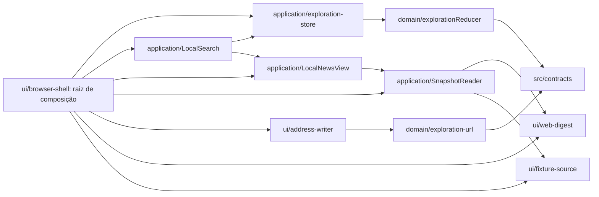
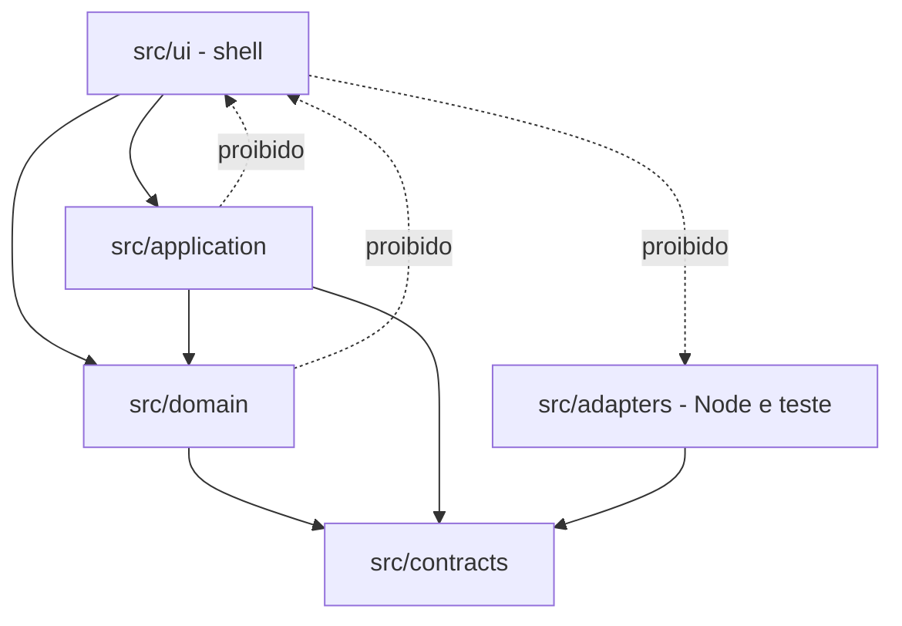

# Architecture Spine — Epic 7: Pesquisar, localizar e retomar contexto

Fixa as invariantes que o consumidor de navegador das stories do Epic 7 precisa compartilhar. O núcleo local de 7.1 já foi aceito; o que falta é a fronteira do navegador, hoje inexistente no repositório. Não reabre decisões do spine de iniciativa nem amplia detalhe por story. As três emendas que este épico pediu ao spine pai foram aplicadas em 14/10/2026; ver **Emendas aplicadas ao spine pai**.

## Design Paradigm

Herda o monólito modular com portas e adaptadores. A camada nova é o **shell de navegador** em `src/ui/`: um adaptador de borda, único lugar autorizado a tocar DOM, `history`, `localStorage` e `crypto.subtle`. Cada página tem **uma raiz de composição** que cria uma instância de cada colaborador e os entrega aos consumidores; Globo (Epic 4) e Busca (Epic 7) recebem essas instâncias e nunca as constroem. `domain` e `application` permanecem sem conhecimento de navegador.



## Inherited Invariants

| Inherited | From parent | Binds here |
| --- | --- | --- |
| AD-1 | architecture-LLMs-2026-10-10 | Somente `domain` define regras; o shell consulta projeções e emite intenções, nunca cria regra alternativa. |
| AD-2 | architecture-LLMs-2026-10-10 | O Publicador é o único escritor do manifesto v2, com a tabela acumulada `companyMergedInto`; validador único `assertCompanyMergedInto`; o leitor usa uma revisão por `frame` e rejeita o v1. |
| AD-3 | architecture-LLMs-2026-10-10 | IDs opacos estáveis; merge exige decisão humana. Proíbe substituição heurística no shell. |
| AD-9 | architecture-LLMs-2026-10-10 | Amplify serve só código e fixtures; todo dado do dono passa por Cognito → API Gateway (JWT) → Lambda → S3 privado. Limita o caminho de dados (AD-21). |
| AD-10 | architecture-LLMs-2026-10-10 | Um reducer é o único escritor semântico; hidratação de URL não dispara persistência; aliases legados são Q11. |
| AD-14 | architecture-LLMs-2026-10-10 | Local/test usam fixtures sintéticas; nenhum deploy por teste ou build. Governa AD-21 e AD-25. |
| AD-15 | architecture-LLMs-2026-10-10 | Notícia suprimida não reaparece em nenhuma superfície, inclusive resultados de Busca. |
| AD-16 | architecture-LLMs-2026-10-10 | `src/contracts/` é a única definição executável de formatos de fronteira; mudança incompatível exige nova versão. |
| AD-26 | architecture-LLMs-2026-10-10 | Uma `APP_ORIGIN` por ambiente gera CORS, Origin, callbacks do Cognito e a CSP do shell (`connect-src` para API e Cognito). Governa os headers de AD-25. |
| AD-27 | architecture-LLMs-2026-10-10 | `ManifestResponse` sem `objectKey`, slice em bytes verbatim, porta HTTP única com `access-lost`, refresh só pela raiz. Governa o caminho real de dados do shell após Q2. |
| Q2, Q11 | architecture-LLMs-2026-10-10 | Q2 governa persistência, IaC, custo e provas da camada AWS; Q11 governa aliases de URL. Este spine os estende, não cria gates novos. |

## Emendas aplicadas ao spine pai

Levantadas aqui e aplicadas no spine pai em 14/10/2026 (modo Update). Os textos herdados acima já refletem as emendas.

| Emenda | Pai, depois da emenda | Efeito aqui |
| --- | --- | --- |
| Versão do manifesto | AD-2 fixa `schemaVersion: 2` com a tabela acumulada `companyMergedInto`, válida contra qualquer revisão anterior; o v1 é rejeitado, sem leitor dual | AD-22 simplificado: o despachante repassa a tabela inteira, sem comparar revisões. O ramo de substituição do critério 4 depende só da implementação do manifesto v2 pelo núcleo Domain/Contracts |
| Hospedagem e AD-9 | Amplify Hosting serve só código e fixtures; dados e comandos passam por Cognito → API Gateway HTTP API (JWT) → Lambda `nodejs24.x` → S3 privado; AD-26 e AD-27 fixam origens e leitura HTTP | AD-21 continua valendo até essa camada existir e ser provada (Q2). O critério 3 segue sem cumprimento. A guarda de tokens do pai (memória + `sessionStorage` só no redirect) é a exceção nomeada ao AD-21 |
| Local do store | O seed coloca o store de exploração em `src/application/` e o shell em `src/ui/` | AD-18 coincide com o seed |

## Invariants & Rules



### AD-18 — O wrapper do store tem um proprietário único

- **Binds:** todo consumidor de navegador dos Epics 4 e 7; `explorationReducer`.
- **Prevents:** Globo e Busca embrulharem o reducer separadamente e divergirem na Empresa selecionada; o store adquirir DOM ou `localStorage`; despacho reentrante corromper a sequência de `intentToken`; dois wrappers responderem de formas diferentes após o descarte.
- **Rule:** `src/application/exploration-store.mjs` é o único wrapper: `getState`, `dispatch`, `subscribe` e `dispose`, todos síncronos sobre `explorationReducer`. Cada `dispatch` confirma o novo estado e chama cada listener, na ordem de inscrição, com `(state, {intent, effects})`; depois devolve o mesmo `{state, effects}` ao chamador. Quem despacha ignora os efeitos devolvidos: eles são executados pelo listener de efeitos da raiz de composição, então um `camera` despachado pela Busca ou pelo Globo tem sempre o mesmo executor. Um `dispatch` feito enquanto outro está em andamento lança `REENTRANT_DISPATCH`; um listener que precise reagir com novo intent o agenda com `queueMicrotask`. `subscribe` não emite estado inicial e devolve `unsubscribe`. Depois de `dispose`, `getState` e `dispatch` lançam `STORE_DISPOSED`. Nenhum outro módulo mantém estado de exploração.

### AD-19 — Um escritor de endereço, com tabela total por intent

- **Binds:** FR-38; critério 3 da Story 7.1; consumidores de URL dos Epics 4 e 7.
- **Prevents:** histórico inflado por toggle de Camada; um Back expulsar Andre do app; `popstate` duplicar entradas; dois escritores de endereço; endereço divergir do estado após remap; conversa, Histórico ou segredo entrarem na URL.
- **Rule:** `src/ui/address-writer.mjs` é o único escritor do endereço; é o primeiro listener inscrito pela raiz de composição e classifica pelo `intent` que recebe. Após cada `dispatch`, compara `explorationQuery(novoEstado)` com o endereço atual; se forem iguais, não escreve. Caso contrário, aplica a tabela abaixo. Um teste de exaustividade sobre `INTENT_TYPES` falha se surgir intent sem classificação; `src/contracts/exploration.mjs` passa a exportar `INTENT_TYPES` (as chaves de `INTENT_FIELDS`), mudança do núcleo Domain/Contracts sob AD-16. Somente a raiz de composição despacha `hydrateUrl`, e só na carga da página e em `popstate`. O endereço é sempre exatamente a saída de `explorationQuery` — o escritor nunca acrescenta parâmetros. Usa a History API, não a Navigation API. Escritas `replaceState` consecutivas são agrupadas no máximo uma por quadro, e uma substituição pendente é aplicada antes de qualquer `pushState`; escrita recusada pelo navegador (limite de taxa) não lança erro à interface e é refeita na mudança seguinte. Ordem após o `dispatch`: primeiro o endereço, depois os efeitos, na ordem do array.

| Intent | Escrita |
| --- | --- |
| `company`, `tab`, `navigate` | `pushState` |
| `base`, `preference`, `advanceSnapshot` | `replaceState` |
| `hydrateUrl` | `replaceState` somente se o endereço hidratado não for canônico (ex. alias legado); caso contrário nenhuma. Nunca `pushState` |
| `panel`, `openNews`, `escape`, `camera`, `callback` | nenhuma (não alteram a query; a comparação confirma) |

Selecionar um resultado de Busca produz `advanceSnapshot` seguido de `navigate`, ou seja, uma substituição e uma entrada nova. Alternar Camadas é o intent `preference` com campo `layers`: altera a preferência durável e apaga o override de sessão vindo da URL.

### AD-20 — Digest por porta injetada, nunca por adapter de Node

- **Binds:** qualquer bundle de navegador; `SnapshotReader`.
- **Prevents:** um bundler arrastar `node:crypto` para o cliente; duplicação de `sha256Text`; porta devolver `ArrayBuffer` e reprovar toda comparação de integridade; leitura de fixture que pule a verificação de digest.
- **Rule:** `src/ui/web-digest.mjs` calcula `SHA-256` com `crypto.subtle.digest` sobre os bytes UTF-8 do texto (`TextEncoder`) e devolve **hex minúsculo de 64 caracteres**, o formato que o contrato fixa (`/^[a-f0-9]{64}$/`) e que `SnapshotReader` compara com `!==`. Uma fixture compartilhada, com texto não ASCII, prova que essa porta e `sha256Text` produzem o mesmo hex. Os dados chegam a `LocalNewsView` sempre através de `SnapshotReader`, inclusive com fixtures: nenhuma composição injeta snapshot sem verificação de digest. `src/adapters/memory-snapshots.mjs` permanece exclusivo de Node e teste. `crypto.subtle` exige contexto seguro; o shell só opera sob HTTPS ou `localhost`.

### AD-21 — Fixtures sintéticas marcadas; dado real e Histórico vedados até Q2

- **Binds:** todo consumidor de navegador dos Epics 4 e 7 enquanto Q2 estiver aberto; critério 3 da Story 7.1; Story 7.3.
- **Prevents:** fixture virar caminho de produção silenciosamente; dado privado exposto como asset público contra AD-9; Histórico ou conversa gravados em armazenamento do navegador sem autorização; o incremento de navegador ser tomado como conclusão da Story 7.1.
- **Rule:** `src/ui/fixture-source.mjs` é a única fonte de dados do navegador. Fornece manifesto e slices sintéticos ao `SnapshotReader` e o feedback a `LocalNewsView`, e exporta o único marcador de procedência que a interface exibe. É vedado servir Cadastro real, snapshot curado ou qualquer JSON privado por esse caminho. Escritas do shell limitam-se a `persistPreferences` em `localStorage`, só com chaves de `PREFERENCE_KEYS`, mais a exceção nomeada do AD-9 do pai (`code_verifier` e `state` em `sessionStorage` só durante o redirect; tokens só em memória); conversa, Histórico e consultas nunca são gravados no navegador, e a Story 7.3 não começa antes de Q2 e Q7. A exigência de autenticação do critério 3 não pode ser cumprida com fixtures; ela depende da camada Cognito/API do AD-9 existir e ser provada (Q2). A Story 7.1 permanece `in-progress` até Q2 (autenticação, critério 3), Q5 (ticker em MERCADOS, critério 2) e a implementação do manifesto v2 (substituição, critério 4). Comparação de `Symbol` como `authorizeRead: c => c === owner` é fixture, não autorização.

### AD-22 — Remaps declarados pelo Publicador, repassados sem dedução

- **Binds:** FR-37, FR-38; critério 4 da Story 7.1; contrato de manifesto; `advanceSnapshot`.
- **Prevents:** entidade mesclada virar silenciosamente `company-unavailable`, inclusive quando o leitor salta revisões; substituição por heurística de nome contra AD-3; dois consumidores filtrarem remaps de formas diferentes.
- **Rule:** formato, semântica e validador único são os do AD-2 do pai: tabela acumulada `companyMergedInto`, válida contra qualquer revisão anterior. A implementação segue AD-16 e o inventário de migração de `contracts.md`: autoria do núcleo Domain/Contracts, fixtures válidas e inválidas, `MergeDecision` como única fonte e Publicador em memória emitindo a tabela, tudo antes do consumidor. O frame de `LocalNewsView` expõe `companyMergedInto`; `LocalSearch` e qualquer outro despachante a repassam inteira no campo `companyRemaps` de `advanceSnapshot`, sem comparar revisões. O reducer decide: aplica só entradas cujo `from` está no índice anterior e ignora as demais. É vedado ao consumidor filtrar, deduzir ou compor remaps.

### AD-23 — O shell possui o descarte, em ordem fixa

- **Binds:** consumidores de navegador dos Epics 4 e 7; lifecycle sob Q3.
- **Prevents:** callback de uma instância encerrar operação de outra (CR-05); resultado de revisão privada publicado após perda de permissão; subscription órfã alimentando renderer morto.
- **Rule:** cada `LocalSearch` pertence a exatamente uma instância de store e é descartada com ela. Ao trocar de instância ou perder permissão (o evento `access-lost` da porta HTTP do AD-27 do pai, ou logout), a raiz de composição executa, nesta ordem: `LocalSearch.cancel()`, todos os `unsubscribe`, `store.dispose()`, e descarta também `SnapshotReader` e `LocalNewsView`, que guardam a última revisão lida; uma nova sessão recria todos. Com `cancel()` primeiro, uma `view.frame()` ainda pendente resolve como `superseded` sem publicar e sem ler o store descartado. O teste de descarte prova que nenhuma resposta é publicada depois da perda de permissão, além do isolamento entre instâncias.

### AD-24 — Contratos são o vocabulário canônico; aliases do protótipo têm tabela única no domínio

- **Binds:** FR-38; Q11 herdado; borda de URL.
- **Prevents:** Globo e Busca interpretarem o mesmo endereço de formas diferentes; alias legado vazar para o estado ou para o endereço serializado; URL do protótipo alterar preferência persistida.
- **Rule:** o vocabulário de `src/contracts/` é o único canônico. A tabela de aliases vive em `src/domain/exploration-url.mjs`, dentro de `parseExplorationUrl`, para que todo consumidor e o teste em Node compartilhem a mesma tradução; o shell nunca traduz. Hoje essa função **não** traduz nenhum alias do protótipo; a tabela é trabalho novo, sob Q11. Mapeamento: `select=` → `company` e `tab=globo` → `globe`; a forma canônica prevalece quando coexistem. `view=` segue a regra Q11 já implementada. Um endereço legado sem `company` não altera a seleção da sessão, como hoje (CR-08); a tradução não inventa `company=`. Um `company=` anterior a um merge continua virando `null` até a extensão de Q11 do pai, que resolve pela tabela `companyMergedInto` com `EXPLORATION_VERSION` 3. `mode=`, `reader=` e `pov=` são ignorados: tocam preferência ou câmera, que a URL não pode definir (AD-10). `explorationQuery` nunca emite alias.

### AD-25 — O shell é publicado ao lado do preview e testado por portas

- **Binds:** build, deploy e testes do shell; herda AD-14.
- **Prevents:** três implementadores produzirem o artefato por caminhos diferentes; o shell tirar o preview aprovado do ar; regras de header inertes no host; AD-19 e AD-23 sem teste executável; o shell herdar o token Cesium do preview.
- **Rule:** `scripts/build-ui-preview.mjs` continua sendo o único build. Ele copia `src/contracts`, `src/domain`, `src/application` e `src/ui` para `dist/ui/app/` preservando os nomes das pastas, para que os imports relativos funcionem sem reescrita, e copia `src/ui/index.html` para `dist/ui/app/index.html`; as variáveis Cesium exigidas pelo build continuam valendo para o preview; os mockups e o gate `dist/ui/index.html` de `amplify.yml` ficam intactos. `npm run check` falha se algum módulo alcançável a partir de `src/ui/` importar `src/adapters/` ou `node:`. Headers do shell ficam em `customHttp.yml`, o arquivo que o Amplify lê (o `_headers` gerado pelo build não governa o Amplify): `/app/**/*.mjs` com `Content-Type: text/javascript`, `/app/**` com `Content-Security-Policy: default-src 'self'` enquanto só houver fixtures; com a camada autenticada, a CSP passa a ser gerada pelo AD-26 do pai (`connect-src` para API e Cognito); e `Cache-Control: no-store` para as fixtures. O shell não lê `cesium-config.json` nem nenhum token. `history`, `storage` e o relógio são portas injetadas pela raiz de composição, e `crypto.subtle` existe em Node 24; com isso o escritor de endereço, o descarte e o digest são testados com `node --test`, sem DOM nem pacote novo. Deploy continua acontecendo só pelo pipeline existente, nunca por teste ou build local.

## Consistency Conventions

| Concern | Convention |
| --- | --- |
| Direção de dependência | `ui` → `application` → `domain` → `contracts`. `ui` nunca importa `src/adapters/`; `application` e `domain` nunca importam `ui`. |
| Composição | Uma raiz por página (`src/ui/browser-shell.mjs`) cria store, reader, view, busca, escritor, digest e fonte de fixtures; consumidores recebem instâncias. |
| Efeitos | O listener de efeitos da raiz, inscrito depois do escritor de endereço, executa os efeitos de cada `dispatch`; quem despacha não os executa. |
| Ordem de snapshots | Todo `advanceSnapshot` deriva de frames do único `SnapshotReader` da página, e só é despachado se a revisão do frame for a `current` do reader naquele instante; frame mais antigo é descartado (CR-04). |
| Ligação ao DOM | Elementos de Empresa, Modelo e Notícia carregam o ID canônico da projeção; a interface não mantém arrays próprios de entidades. O diálogo integrado substitui `aaSearchRows()` no consumidor; o mockup permanece como referência visual. |
| Procedência | Toda superfície alimentada por fixture exibe o marcador de `fixture-source`. |
| `Esc` com a Busca aberta | A Busca é a superfície mais alta: o shell a fecha, devolve o foco ao botão ⌕ e não despacha `escape`. Fechada a Busca, `Esc` segue a escada do reducer (AD-10). |
| Ticker | Selecionar um ticker despacha `navigate` (Empresa/Terminal no GLOBO). Abrir o ativo em MERCADOS depende de Q5 e não acontece nesta fatia. |
| Indisponibilidade | O diálogo de Busca mostra o `status: 'unavailable'` de `LocalSearch`; as demais superfícies mostram `warning` do store. Duração e dismiss do aviso (CR-09) pertencem à apresentação sob Q3. |

## Stack

| Name | Version |
| --- | --- |
| Node.js (desenvolvimento e teste) | >=24.0.0 (`engines`; `amplify.yml` usa 24) |
| JavaScript ES modules (`.mjs`) | ES2022+, sem transpilação |
| Runner de teste | `node --test` nativo |
| Web Crypto (`crypto.subtle`) | API de plataforma, contexto seguro |

Nenhum pacote novo é introduzido por este spine. Bundler e forma de servir módulos permanecem sob Q9; até lá vale a cópia de módulos de AD-25.

## Structural Seed

```text
src/
  contracts/     # vocabulário canônico; assertCompanyMergedInto (AD-2 do pai)
  domain/        # explorationReducer; exploration-url com tabela de aliases (AD-24)
  application/   # LocalSearch, LocalNewsView, SnapshotReader, exploration-store (AD-18)
  adapters/      # memory-*: Node e teste apenas, nunca no bundle
  ui/
    browser-shell.mjs    # raiz de composição, efeitos, descarte (AD-23)
    address-writer.mjs   # único escritor do endereço (AD-19)
    web-digest.mjs       # porta digest hex (AD-20)
    fixture-source.mjs   # fixtures sintéticas e marcador de procedência (AD-21)
    http-snapshot-port.mjs  # porta HTTP única, após Q2 (AD-27 do pai)
    auth/                # PKCE S256 próprio, após Q2 (AD-9 do pai)
    index.html           # entrada copiada para dist/ui/app/ (AD-25)
```

## Capability → Architecture Map

| Capability / Area | Lives in | Governed by |
| --- | --- | --- |
| Busca global (FR-37) | `application/local-search.mjs` + diálogo em `ui/` | AD-18, AD-23, herda AD-15 |
| Estado na URL (FR-38) | `domain/exploration-url.mjs` + `ui/address-writer.mjs` | AD-19, AD-24, herda AD-10 |
| Store de exploração | `application/exploration-store.mjs` | AD-18, herda AD-10 |
| Leitura de dados | `SnapshotReader` + `ui/fixture-source.mjs` + `ui/web-digest.mjs` | AD-20, AD-21, herda AD-2, AD-9 |
| Reconciliação de entidade | manifesto → frame → `advanceSnapshot` | AD-22, herda AD-3 |

## Deferred

- **Q2, antes de qualquer dado real no navegador e do critério de autenticação de 7.1:** provedor e camada autenticada já estão decididos no AD-9 do pai (AWS). Faltam persistência de controle, agendador, IaC, região, custo e as provas de autenticação; até lá vale AD-21.
- **CR-02, override de Empresa promovido no refresh:** comportamento preexistente mantido; reconciliar quando houver refresh real de snapshot no navegador (Q2). CR-08 está decidido em AD-24.
- **Interface e acessibilidade (Q3):** foco, `Esc`, teclado, toque, ordem de Tab e matriz de browser pertencem às stories de UI; este spine fixa apenas o lifecycle (AD-23).
- **CR-03, CR-06, CR-07:** `maybe-false` não verificados, dependentes de consumidor ou renderer integrado; revisitar quando o shell existir. CR-04 é tratado pela convenção de ordem de snapshots.
- **Ticker em MERCADOS (Q5):** instrumentos, índices e a abertura do painel MERCADOS a partir da Busca.
- **Stories 7.2 e 7.3:** chat, fontes pagas, orçamento separado e Histórico seguem sob Q1/Q7, e Histórico também sob Q2 (AD-21).
- **Token Cesium no build de preview:** é token público restrito por origem, emitido para o protótipo; seu tratamento pertence a Q6/Q9, não a este épico.
- **Bundler (Q9):** CDN versionada ou pacote integrado; AD-20 e AD-24 valem em qualquer escolha.
