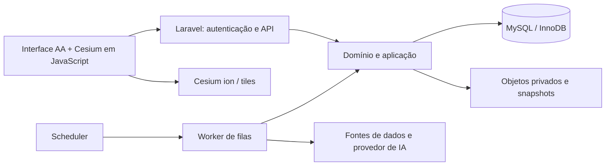

# IRIS Global / LLMs — estudo de PHP e MySQL

Data: 12/10/2026. Status: estudo para decisão; nenhuma mudança de stack aprovada ou implementada por este documento. Método: inspeção do projeto e consulta a documentação oficial. Não houve benchmark, instalação, contratação ou deploy.

Decisão posterior: após comparar InfinityFree premium/iFastNet, Vercel e GitHub Pages, Andre decidiu “vamos manter a vercel” em 12/10/2026. O [comparativo de hospedagem](hospedagem-ifastnet-vercel-github-pages-2026-10-12.md) registra Vercel como escolhida. Preservar o núcleo JavaScript atual; este estudo não autoriza migração PHP/MySQL. Persistência e adequação da arquitetura à Vercel continuam decisões de implementação pendentes.

## Parecer

**O projeto pode usar PHP e MySQL no backend, preservando a interface Artificial Analysis Light/Dark e o Cesium. Uma reescrita integral não apresenta benefício demonstrado neste momento.**

Minha recomendação para o estado atual é preservar a interface e o núcleo JavaScript, escolher a persistência e a hospedagem antes de decidir trocar de linguagem. Laravel + MySQL é uma alternativa consistente se houver preferência por desenvolvimento PHP, experiência da equipe ou uma hospedagem adequada já disponível. Se a motivação principal for ter um banco relacional durável, JavaScript/TypeScript + MySQL também atende e exige menos portabilidade das regras existentes.

PHP executaria autenticação, APIs, ingestão, curadoria, consultas e orquestração de IA. MySQL armazenaria dados e transações. O navegador continuaria executando JavaScript para seleção, filtros, gráficos, diálogos e globo. CesiumJS é uma biblioteca JavaScript para visualização geoespacial no navegador; trocar o servidor não substitui seu renderizador. [CesiumJS](https://cesium.com/platform/cesiumjs/).

## O que já existe e o que ainda é proposta

| Camada | Evidência no projeto | Consequência para a decisão |
| --- | --- | --- |
| Interface | Templates HTML/CSS/JS; Artificial Analysis Light é a abertura padrão, Dark e versões anteriores preservados | O design aprovado pode ser mantido com qualquer backend |
| Globo Cesium | Protótipo separado com pontos demonstrativos, terreno, prédios e Google 3D; configuração de origem e tokens de leitura | Reaproveitar a integração; avaliar a renderização separadamente da linguagem do servidor |
| Notícias e finanças | Notícias originais em snapshot junto de demonstrações; cotações e diálogos financeiros demonstrativos | Ainda é necessário implementar provedores reais, cobertura, licenças e atualização |
| Núcleo | Módulos ESM de domínio, aplicação, contratos e adaptadores em memória; fixtures e testes locais | Existem regras reutilizáveis; os adaptadores atuais não constituem persistência de produção |
| Arquitetura | Spine final registra monólito modular; Vite/TypeScript + Workers/D1/R2 aparece como seed `[ASSUMPTION]` | A documentação final não significa infraestrutura adotada ou implantada |
| Publicação | Domínio pretendido `irisglobal.com.br`; pacote do preview preparado; hospedagem não definida e deploy adiado | O endereço não determina a stack; o PRD continua prevendo acesso privado do dono |

Fontes locais: [templates e integração Cesium](../../../docs/ui-templates.md), [núcleo local](../../../docs/local-core-fixtures.md), [PRD](../prds/prd-LLMs-2026-10-07/prd.md), [Architecture Spine](../architecture/architecture-LLMs-2026-10-10/ARCHITECTURE-SPINE.md) e [evidência da arquitetura](../architecture/architecture-LLMs-2026-10-10/technology-evidence.md).

O comparativo considera um painel pessoal privado, atualizações financeiras aproximadamente a cada quinze minutos no pregão, notícias/modelos em ciclos horários e expansão prevista para cerca de 200 pontos. Esses são requisitos, não resultados medidos em produção. O teto próximo de US$ 5/mês no PRD refere-se aos agentes de notícias e descoberta; não é orçamento total de hospedagem, mapas, fontes financeiras e chat.

## Comparação das alternativas

As avaliações abaixo são julgamentos de adequação ao projeto, não medições de desempenho.

| Critério | JS/TS + Workers/D1/R2, proposta atual | PHP/Laravel + MySQL | JS/TS + MySQL, alternativa de controle |
| --- | --- | --- | --- |
| Reuso do núcleo existente | Alto; ainda exige adaptadores e integração | Interface reaproveitada; domínio e aplicação do servidor precisam ser portados | Alto; regras existentes podem permanecer, com novos adaptadores |
| Contratos entre UI e servidor | Mesma linguagem facilita compartilhar validadores | Duas linguagens exigem schema neutro e testes de compatibilidade | Mesma linguagem facilita compartilhar validadores |
| Persistência e concorrência | SQL gerenciado, com semântica e limites próprios do D1 | InnoDB oferece transações e bloqueios para operações concorrentes | Benefícios do mesmo MySQL sem depender de PHP |
| Tarefas automáticas | Execução gerenciada, condicionada aos limites e ao desenho dos jobs | Scheduler e filas do Laravel; host precisa executar e supervisionar os processos | Scheduler e filas precisam ser escolhidos e operados |
| Agentes e chat | Preserva ambiente JS; provedor e orçamento continuam pendentes | SDK oficial de IA e streaming disponíveis; integração ainda necessária | Preserva ambiente JS; provedor e orçamento continuam pendentes |
| Operação | Menos gestão de servidor; mais dependência dos serviços Cloudflare | VPS exige manutenção; plataforma gerenciada transfere parte dessa operação | Perfil operacional depende do host; MySQL também precisa de recuperação |
| Portabilidade | Adaptadores D1/R2/Access precisam ser substituídos ao mudar de plataforma | Aplicação PHP/MySQL pode ser alojada em ambientes compatíveis, com ajustes operacionais | Aplicação JS/MySQL também pode mudar de ambiente compatível |
| Globo e visual | Dependem principalmente do frontend e dos serviços de mapa | Mesma dependência; sem ganho gráfico automático | Mesma dependência; sem ganho gráfico automático |
| Custo da mudança agora | Menor portabilidade; falta provar a viabilidade da proposta | Maior trabalho de tradução e validação das regras existentes | Menor portabilidade que PHP, mas introduz operação de MySQL |

D1 também é um banco SQL: o ganho de persistência não é exclusivo do MySQL. A documentação do D1 registra execução serial por banco, teto de 500 MB no Free e 10 GB no Paid; essas condições precisam ser confrontadas com o volume real. Isso não prova que ele será insuficiente para um usuário. [Limites do D1](https://developers.cloudflare.com/d1/platform/limits/).

Workers possui limites de CPU, memória e subrequisições. Espera de rede não equivale a consumo de CPU. Coletas devem ser repartidas e medidas, em vez de concluir que um job longo de IA necessariamente inviabiliza a plataforma. [Limites do Workers](https://developers.cloudflare.com/workers/platform/limits/).

## Efeito em cada parte do produto

**Interface e globo.** Manter HTML/CSS, temas, galeria, estado de navegação e Cesium, substituindo progressivamente dados demonstrativos por respostas da API. A integração com um backend PHP é tecnicamente compatível, mas ainda precisaria de teste. Otimização do 3D envolve quantidade de entidades, níveis de detalhe, resolução, tráfego de tiles e dispositivo. O estudo não demonstra melhora de FPS em nenhuma stack.

**Notícias, empresas e mercado.** MySQL permite organizar empresas, instrumentos, vínculos de fontes, cotações, séries, notícias, feedback e histórico. Esse benefício também existe com um backend JS usando MySQL. Cada cotação deve manter símbolo da fonte, moeda, unidade, horário, calendário e proveniência. Imagens originais precisam conservar vínculo e crédito; PHP não concede direito de republicação nem resolve sozinho ingestão, deduplicação ou cobertura financeira.

**Curadoria e orçamento de IA.** InnoDB oferece bloqueios para concorrência; MySQL dispõe de `DECIMAL` para valores exatos. Proponho preservar os inteiros de microUSD do ledger existente e representar números decimais monetários sem conversão para `float`. Esses mecanismos são apropriados para reservas de custo, revisão e idempotência, mas a correção depende do desenho e dos testes. [InnoDB](https://dev.mysql.com/doc/refman/8.4/en/innodb-locking.html), [DECIMAL](https://dev.mysql.com/doc/refman/8.4/en/fixed-point-types.html).

Uma operação de reserva deve bloquear ou atualizar condicionalmente o saldo mensal, validar gasto + reservado + máximo, registrar uma chave única e confirmar tudo na mesma transação. A chamada ao provedor acontece fora dessa transação; sua liquidação é idempotente e uma resposta desconhecida mantém a reserva. Não manter bloqueio SQL durante a espera de uma API. Laravel oferece transações e tratamento de deadlocks; isso não torna segura a repetição de chamadas externas cobradas dentro da transação. [Transações Laravel](https://laravel.com/framework/docs/13.x/database#database-transactions).

**Agentes.** PHP é adequado para consultar APIs e orquestrar as ferramentas previstas. Laravel documenta SDK oficial com agentes, saída estruturada e provedores como OpenAI, Anthropic e OpenRouter. Isso favorece a alternativa PHP; o framework não implementa automaticamente nossas restrições de ferramentas, orçamento, curadoria, proveniência e retenção. Compatibilidade deve ser verificada por recurso e provedor. [Laravel AI SDK](https://laravel.com/framework/docs/13.x/ai-sdk).

Chat em streaming também é viável: Laravel oferece SSE, consumível pelo JavaScript atual. Na hospedagem escolhida, testar timeouts, buffering e capacidade de atender solicitações simultâneas. Não é necessário adotar WebSockets somente para exibir uma resposta progressiva. [Respostas SSE](https://laravel.com/framework/docs/13.x/responses#event-streams).

Para eventual busca semântica, não presumir que instalar MySQL ativa todos os recursos vetoriais anunciados pelo Laravel. As notas do framework apresentam integração com PostgreSQL/pgvector; escolher armazenamento vetorial apenas quando houver um requisito concreto, considerando também soluções externas e seus custos. [Laravel 13](https://laravel.com/framework/docs/13.x/releases).

**Atualizações automáticas.** Laravel dispõe de scheduler e filas, inclusive com backend relacional. Minha proposta inicial seria uma fila no MySQL para reduzir componentes, sujeita a medição; Redis não seria obrigatório. Jobs precisam de supervisão, reinício, limites, retries e publicação após commit. Recursos de evitar sobreposição não substituem o fencing e a publicação condicional exigidos pela arquitetura. [Filas](https://laravel.com/framework/docs/13.x/queues), [Scheduler](https://laravel.com/framework/docs/13.x/scheduling).

Minha inferência operacional: hospedagem compartilhada só é candidata se permitir esses processos, cron adequado e streaming. Um plano que apenas serve PHP e fornece MySQL pode não atender ao produto. VPS ou plataforma gerenciada compatível merece comparação, sem contratação nesta etapa.

## Arquitetura candidata em PHP

Se PHP for escolhido, eu adotaria um monólito modular Laravel, com PHP 8.5 suportado e MySQL 8.4 como candidato a validar na hospedagem. Laravel 13 suporta PHP 8.3–8.5; confirmar extensões e versões exatas antes do scaffold. [Suporte PHP](https://www.php.net/supported-versions.php), [requisitos Laravel](https://laravel.com/framework/docs/13.x/deployment).

Estrutura de dados candidata: catálogo e aliases; modelos e preços; instrumentos e cotações; notícias e feedback; propostas e decisões; leases e revisões de publicação; reservas e liquidações de orçamento; conversas e eventos. Imagens e snapshots grandes podem usar armazenamento de objetos privado. Nenhum schema ou serviço dessa proposta foi criado.

Preservar `/api/v1`, IDs opacos, JSON camelCase e timestamps UTC. O princípio de contrato único permanece, mas seu mecanismo precisa mudar: um schema neutro versionado, como JSON Schema/OpenAPI, deve ser a autoridade estrutural para PHP e JS. Fixtures comuns e testes entre produtor e consumidor cobrem as regras semânticas. Não manter duas cópias independentes dos mesmos contratos.

A privacidade requer proteger páginas, dados e objetos, além de verificar o dono nos comandos. Se o PHP for servido atrás de outro gateway, impedir bypass direto ao servidor. As configurações públicas de leitura do Cesium conservam suas restrições de origem; segredos de APIs financeiras e LLM ficam no servidor. Esses requisitos já pertencem ao projeto.

## Custo, esforço e riscos da mudança

O custo mensal deve somar aplicação, banco, backups, objetos, filas, tráfego, observabilidade, fontes, IA e mapas. Workers Paid tem cobrança mínima de US$ 5/mês por conta, com franquias e excedentes; esse valor não é previsão do custo completo do IRIS Global. PHP/MySQL não tem preço mensal único: depende da hospedagem e da operação. [Preço Workers](https://developers.cloudflare.com/workers/platform/pricing/).

Custos e condições do Cesium ion seguem o plano, uso e licenciamento da conta, independentemente da linguagem do backend. As fontes financeiras e os modelos de IA também mantêm suas próprias condições. [Planos Cesium ion](https://cesium.com/platform/cesium-ion/pricing/).

Não há base para afirmar que PHP será mais barato ou rápido, nem para atribuir prazo fechado ou percentual de reaproveitamento. Faltam host, experiência da equipe, volume de dados, plano de retenção e medições de jobs. O custo de mudança concentra-se em portar domínio/aplicação, transportar fixtures, compatibilizar contratos e integrar a UI. A persistência, autenticação e coleta reais precisam ser construídas em qualquer alternativa.

Uma reescrita integral também criaria trabalho de reconstrução do visual e do estado de navegação sem um benefício identificado. Um backend PHP com o frontend preservado reduz esse risco. Manter dois backends permanentes duplicaria operação e responsabilidades; eventual comparação deve ter um escopo pequeno e temporário.

## Como decidir com evidência

Antes de uma migração, recomendo uma prova vertical limitada e reversível. Não foi executada neste estudo.

1. Definir host candidato e limite separado de infraestrutura; confirmar cron, filas, MySQL, backups, objetos privados e streaming.
2. Conectar uma pequena superfície da interface a uma API privada com catálogo e dados financeiros de fixture, mantendo IDs, seleção e Light/Dark.
3. Exercitar reservas simultâneas perto do teto, duplicação de jobs, liquidação repetida, resposta desconhecida, disputa de revisão e publicação parcial. Verificar que não há orçamento excedido por corrida nem revisão inconsistente.
4. Demonstrar um job agendado e recuperação após reinício; testar restore, acesso negado a páginas/JSON/objetos e um stream de chat simulado. Integrações pagas ficam dependentes dos gates já existentes.
5. Medir latência, consumo, armazenamento e trabalho operacional. Comparar ao desenho JS/TS usando as mesmas fixtures; medir o globo separadamente.

Aceitar PHP se oferecer vantagem concreta de desenvolvimento ou operação e preservar as invariantes. Manter JS/TS se a mudança apenas traduzir regras sem resolver um problema adicional. Escolher MySQL separadamente da linguagem se a motivação principal for persistência, transações e portabilidade do banco.

## Encaminhamento BMad

O PRD e a Architecture Spine registram planejamento finalizado, com gates de produção pendentes; os protótipos e partes do núcleo têm implementação local. Este estudo acrescenta uma alternativa à decisão de infraestrutura Q2, sem substituir a arquitetura vigente.

Se a alternativa PHP for escolhida, o próximo passo é **[CA] Architecture — `bmad-architecture`**, em contexto novo, para revisar runtime, persistência, contratos entre linguagens, jobs, privacidade, recuperação e custo. A revisão deve considerar também o Cesium aprovado após a arquitetura de 10/10. O PRD só precisa mudar onde houver alteração de requisitos do produto.

Entrada sugerida: “Revise a arquitetura do IRIS Global comparando Laravel/PHP + MySQL com a proposta atual. Use o estudo de 12/10, preserve Artificial Analysis Light/Dark, templates e Cesium, mantenha as invariantes de curadoria, snapshots, orçamento e acesso privado, e registre a decisão de infraestrutura antes da implementação.”

Até essa decisão, a recomendação é continuar preservando os artefatos existentes. Nenhum arquivo de aplicação, token, infraestrutura ou domínio foi alterado por este estudo.
